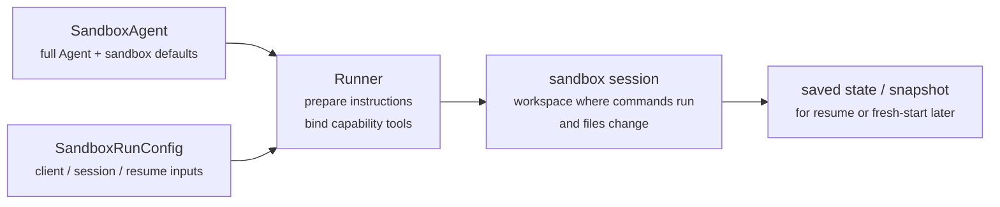
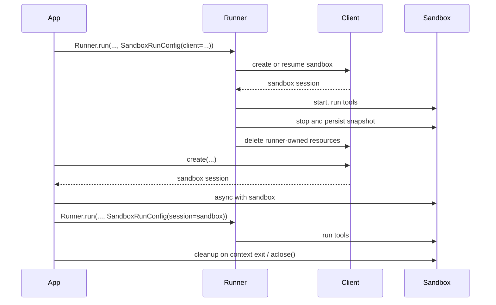

---
search:
  exclude: true
---
# 概念

現代のエージェントは、ファイルシステム上の実ファイルを操作できる場合に最も効果的に動作します。**サンドボックスエージェント**は、専用ツールやシェルコマンドを使用して、大規模なドキュメントセットの検索や操作、ファイルの編集、成果物の生成、コマンドの実行を行えます。サンドボックスは、エージェントがユーザーに代わって作業するために利用できる永続的なワークスペースをモデルに提供します。Agents SDKのサンドボックスエージェントを使用すると、サンドボックス環境と組み合わせたエージェントを簡単に実行できます。適切なファイルをファイルシステム上に配置し、サンドボックスをオーケストレーションすることで、大規模なタスクの開始、停止、再開を容易に行えます。

エージェントが必要とするデータを中心にワークスペースを定義します。GitHub リポジトリ、ローカルのファイルやディレクトリ、合成タスクファイル、S3 や Azure Blob Storage などのリモートファイルシステム、およびユーザーが提供するその他のサンドボックス入力から開始できます。

<div class="sandbox-harness-image" markdown="1">


</div>

`SandboxAgent` は引き続き `Agent` です。`instructions`、`prompt`、`tools`、`handoffs`、`mcp_servers`、`model_settings`、`output_type`、ガードレール、フックなど、通常のエージェントインターフェースを維持し、通常の `Runner` API を通じて実行されます。変更されるのは実行境界です。

- `SandboxAgent` は、通常のエージェント設定に加えて、`default_manifest`、`base_instructions`、`run_as` などのサンドボックス固有のデフォルトや、ファイルシステムツール、シェルアクセス、スキル、メモリ、コンパクションなどの機能を含む、エージェント自体を定義します。
- `Manifest` は、ファイル、リポジトリ、マウント、環境など、新しいサンドボックスワークスペースに必要な初期コンテンツとレイアウトを宣言します。
- サンドボックスセッションは、コマンドが実行され、ファイルが変更されるライブ実行環境です。セッションが提供する分離は、そのバックエンドと設定に依存します。
- [`SandboxRunConfig`][agents.run_config.SandboxRunConfig] は、ライブセッションを直接注入するか、シリアル化されたサンドボックスセッション状態から再接続するか、サンドボックスクライアントを通じて新しいサンドボックスセッションを作成するかなど、実行がサンドボックスセッションを取得する方法を決定します。
- 保存されたサンドボックス状態とスナップショットを使用すると、後続の実行で以前の作業に再接続したり、保存済みコンテンツから新しいサンドボックスセッションを初期化したりできます。

`Manifest` は新規セッション向けのワークスペース契約であり、すべてのライブサンドボックスに関する完全な信頼できる情報源ではありません。実行で有効になるワークスペースは、再利用されたサンドボックスセッション、シリアル化されたサンドボックスセッション状態、または実行時に選択されたスナップショットから取得される場合もあります。

このページ全体で「サンドボックスセッション」とは、サンドボックスクライアントによって管理されるライブ実行環境を指します。これは、[セッション](../sessions/index.md)で説明されている SDK の対話用 [`Session`][agents.memory.session.Session] インターフェースとは異なります。

外側のランタイムは引き続き、承認、トレーシング、ハンドオフ、および実行の再開に必要な状態の追跡を担当します。サンドボックスセッションは、そのバックエンドを通じてコマンドとファイル変更を管理します。適用される分離制御はバックエンドによって決まり、セッション自体が OS レベルの隔離を保証するわけではありません。

### 各要素の連携 {#how-the-pieces-fit-together}

サンドボックス実行では、エージェント定義と実行ごとのサンドボックス設定を組み合わせます。Runner はエージェントを準備し、ライブサンドボックスセッションにバインドし、後続の実行に備えて状態を保存できます。



サンドボックス固有のデフォルトは `SandboxAgent` に保持します。実行ごとのサンドボックスセッションの選択は `SandboxRunConfig` に保持します。

ライフサイクルは、次の 3 つのフェーズで考えてください。

1. `SandboxAgent`、`Manifest`、および機能を使用して、エージェントと新規ワークスペースの契約を定義します。
2. サンドボックスセッションを注入、再開、または作成する `SandboxRunConfig` を `Runner` に渡して、実行を開始します。
3. Runner が管理する `RunState`、明示的なサンドボックス `session_state`、または保存済みワークスペーススナップショットから後で続行します。

シェルアクセスがときどき使用するツールの 1 つにすぎない場合は、[ツールガイド](../tools.md)のホスト型シェルから始めてください。ワークスペースの分離、サンドボックスクライアントの選択、またはサンドボックスセッションの再開動作が設計の一部である場合は、サンドボックスエージェントを使用してください。

## 利用場面 {#when-to-use-them}

サンドボックスエージェントは、次のようなワークスペース中心のワークフローに適しています。

- コーディングとデバッグ。たとえば、GitHub リポジトリの Issue レポートに対する自動修正をオーケストレーションし、対象を絞ったテストを実行する場合
- ドキュメントの処理と編集。たとえば、ユーザーの財務書類から情報を抽出し、記入済みの税務フォーム案を作成する場合
- ファイルに基づくレビューや分析。たとえば、回答前にオンボーディング書類一式、生成済みレポート、成果物バンドルを確認する場合
- 個別のワークスペースを使用するマルチエージェントパターン。たとえば、各レビュアーやコーディング用サブエージェントに専用ワークスペースを与える場合
- 複数ステップのワークスペースタスク。たとえば、ある実行でバグを修正し、後で回帰テストを追加する場合や、スナップショットまたはサンドボックスセッション状態から再開する場合

ファイルへのアクセスや、状態を持つ変更可能なファイルシステムが不要な場合は、引き続き `Agent` を使用してください。シェルアクセスがときどき必要な機能の 1 つにすぎない場合は、ホスト型シェルを追加してください。ワークスペース境界自体が機能の一部である場合は、サンドボックスエージェントを使用してください。

## サンドボックスクライアントの選択 {#choose-a-sandbox-client}

macOS または Linux 上の信頼できるローカル開発環境、あるいは外部で分離された環境内では、`UnixLocalSandboxClient` を使用してください。Linux では、このバックエンドは OS レベルの隔離を追加せず、コマンドをホストプロセスとして実行します。macOS では、`sandbox-exec` を通じてファイルシステム制限を適用しますが、ネットワーク分離は提供しません。

デフォルトでは、新しい Unix ローカルセッションごとに個別の一時ワークスペースが割り当てられます。同じカスタム `Manifest.root` を指定してセッションを設定した場合、それらのセッションはワークスペースを共有します。セッションが分かれていても、OS レベルの分離が保証されるわけではありません。

信頼できない入力の影響を受けるコマンドを含む、信頼できないコマンドを実行する場合は、適切に設定された `DockerSandboxClient` またはホスト型プロバイダーを選択するか、外部の分離環境を用意してください。Windows では、Docker またはホスト型プロバイダーを使用してください。ローカルバックエンドを選択する前に、[Unix ローカル実行の制限](clients.md#decision-guide)を参照してください。

ほとんどの場合、`SandboxAgent` の定義はそのまま維持し、[`SandboxRunConfig`][agents.run_config.SandboxRunConfig] 内のサンドボックスクライアントとそのオプションのみを変更します。ローカル、Docker、ホスト型、リモートマウントの各オプションについては、[サンドボックスクライアント](clients.md)を参照してください。

## 主要な構成要素 {#core-pieces}

<div class="sandbox-nowrap-first-column-table" markdown="1">

| レイヤー | SDK の主要な構成要素 | 答える問い |
| --- | --- | --- |
| エージェント定義 | `SandboxAgent`、`Manifest`、機能 | どのエージェントを実行し、どの新規セッション向けワークスペース契約から開始するか？ |
| サンドボックス実行 | `SandboxRunConfig`、サンドボックスクライアント、ライブサンドボックスセッション | この実行はどのようにライブサンドボックスセッションを取得し、作業はどこで実行されるか？ |
| 保存済みサンドボックス状態 | `RunState` サンドボックスペイロード、`session_state`、スナップショット | このワークフローは、どのように以前のサンドボックス作業へ再接続し、または保存済みコンテンツから新しいサンドボックスセッションを初期化するか？ |

</div>

SDK の主要な構成要素は、次のように各レイヤーへ対応します。

<div class="sandbox-nowrap-first-column-table" markdown="1">

| 構成要素 | 担当範囲 | 確認する問い |
| --- | --- | --- |
| [`SandboxAgent`][agents.sandbox.sandbox_agent.SandboxAgent] | エージェント定義 | このエージェントは何を行い、どのデフォルト設定を引き継ぐべきか？ |
| [`Manifest`][agents.sandbox.manifest.Manifest] | 新規セッションのワークスペースに含まれるファイルとフォルダー | 実行開始時に、どのファイルとフォルダーがファイルシステム上に存在するべきか？ |
| [`Capability`][agents.sandbox.capabilities.capability.Capability] | サンドボックスネイティブの動作 | どのツール、instructions の断片、またはランタイム動作をこのエージェントに関連付けるべきか？ |
| [`SandboxRunConfig`][agents.run_config.SandboxRunConfig] | 実行ごとのサンドボックスクライアントとサンドボックスセッションの取得元 | この実行では、サンドボックスセッションを注入、再開、作成のいずれにするべきか？ |
| [`RunState`][agents.run_state.RunState] | Runner が管理する保存済みサンドボックス状態 | 以前に Runner が管理していたワークフローを再開し、そのサンドボックス状態を自動的に引き継いでいるか？ |
| [`SandboxRunConfig.session_state`][agents.run_config.SandboxRunConfig.session_state] | 明示的にシリアル化されたサンドボックスセッション状態 | `RunState` の外部ですでにシリアル化したサンドボックス状態から再開するか？ |
| [`SandboxRunConfig.snapshot`][agents.run_config.SandboxRunConfig.snapshot] | 新しいサンドボックスセッション向けに保存されたワークスペースコンテンツ | 新しいサンドボックスセッションを保存済みファイルや成果物から開始するか？ |

</div>

実用的な設計順序は次のとおりです。

1. `Manifest` を使用して、新規セッション向けワークスペース契約を定義します。
2. `SandboxAgent` を使用して、エージェントを定義します。
3. 組み込みまたはカスタム機能を追加します。
4. `RunConfig(sandbox=SandboxRunConfig(...))` で、各実行がサンドボックスセッションを取得する方法を決定します。

## サンドボックス実行の準備 {#how-a-sandbox-run-is-prepared}

実行時に、Runner はその定義を具体的なサンドボックスベースの実行へ変換します。

1. `SandboxRunConfig` からサンドボックスセッションを解決します。`session=...` を渡した場合は、そのライブサンドボックスセッションを再利用します。それ以外の場合は、`client=...` を使用してセッションを作成または再開します。
2. 実行に有効なワークスペース入力を決定します。実行でサンドボックスセッションを注入または再開する場合は、既存のサンドボックス状態が優先されます。それ以外の場合、Runner は 1 回限りのマニフェストオーバーライドまたは `agent.default_manifest` から開始します。このため、`Manifest` だけでは、すべての実行における最終的なライブワークスペースは定義されません。
3. 生成されたマニフェストを機能に処理させます。これにより、最終的なエージェントが準備される前に、機能がファイル、マウント、その他のワークスペーススコープの動作を追加できます。
4. 最終的な instructions を固定順序で構築します。SDK のデフォルトサンドボックスプロンプト、または明示的にオーバーライドした場合は `base_instructions`、次に `instructions`、機能の instructions 断片、リモートマウントのポリシーテキスト、レンダリング済みファイルシステムツリーの順です。
5. 機能のツールをライブサンドボックスセッションへバインドし、準備されたエージェントを通常の `Runner` API を通じて実行します。

サンドボックス化によって、ターンの意味が変わることはありません。ターンは引き続きモデルの 1 ステップであり、単一のシェルコマンドやサンドボックス操作ではありません。サンドボックス側の操作とターンの間に固定された 1 対 1 の対応関係はありません。一部の作業はサンドボックス実行レイヤー内で完結しますが、別の操作では、ツールの実行結果、承認、その他の状態など、次のモデルステップを必要とする情報が返される場合があります。実用上、サンドボックスでの作業後にエージェントランタイムが別のモデル応答を必要とする場合にのみ、次のターンが消費されます。

これらの準備手順があるため、`default_manifest`、`instructions`、`base_instructions`、`capabilities`、`run_as` は、`SandboxAgent` を設計する際に検討すべき主要なサンドボックス固有オプションです。

## `SandboxAgent` のオプション {#sandboxagent-options}

通常の `Agent` フィールドに加えて、次のサンドボックス固有オプションがあります。

<div class="sandbox-nowrap-first-column-table" markdown="1">

| オプション | 最適な用途 |
| --- | --- |
| `default_manifest` | Runner が作成する新しいサンドボックスセッションのデフォルトワークスペース。 |
| `instructions` | SDK のサンドボックスプロンプトの後に追加される、追加の役割、ワークフロー、成功基準。 |
| `base_instructions` | SDK のサンドボックスプロンプトを置き換える高度なエスケープハッチ。 |
| `capabilities` | このエージェントに付随させるサンドボックスネイティブのツールと動作。 |
| `run_as` | シェルコマンド、ファイル読み取り、パッチなど、モデル向けサンドボックスツールで使用するユーザー ID。 |

</div>

サンドボックスクライアントの選択、サンドボックスセッションの再利用、マニフェストのオーバーライド、スナップショットの選択は、エージェント上ではなく [`SandboxRunConfig`][agents.run_config.SandboxRunConfig] に設定します。

### `default_manifest` {#default_manifest}

`default_manifest` は、このエージェント向けに Runner が新しいサンドボックスセッションを作成するときに使用されるデフォルトの [`Manifest`][agents.sandbox.manifest.Manifest] です。エージェントが通常、最初から利用すべきファイル、リポジトリ、補助資料、出力ディレクトリ、マウントに使用します。

これはデフォルトにすぎません。実行時に `SandboxRunConfig(manifest=...)` でオーバーライドでき、再利用または再開されたサンドボックスセッションでは既存のワークスペース状態が維持されます。

### `instructions` と `base_instructions` {#instructions-and-base_instructions}

異なるプロンプトでも維持すべき短いルールには、`instructions` を使用します。`SandboxAgent` では、これらの instructions は SDK のサンドボックス基本プロンプトの後に追加されるため、組み込みのサンドボックスガイダンスを維持しながら、独自の役割、ワークフロー、成功基準を追加できます。

SDK のサンドボックス基本プロンプトを置き換える場合にのみ、`base_instructions` を使用してください。ほとんどのエージェントでは設定するべきではありません。

<div class="sandbox-nowrap-first-column-table" markdown="1">

| 設定先 | 用途 | 例 |
| --- | --- | --- |
| `instructions` | エージェントの安定した役割、ワークフロールール、成功基準。 | 「オンボーディング書類を確認してから、ハンドオフしてください。」、「最終ファイルを `output/` に書き込んでください。」 |
| `base_instructions` | SDK のサンドボックス基本プロンプトの完全な置き換え。 | カスタムの低レベルサンドボックスラッパープロンプト。 |
| ユーザープロンプト | この実行に対する 1 回限りのリクエスト。 | 「このワークスペースを要約してください。」 |
| マニフェスト内のワークスペースファイル | より長いタスク仕様、リポジトリローカルの instructions、または範囲が限定された参考資料。 | `repo/task.md`、ドキュメントバンドル、サンプル書類一式。 |

</div>

`instructions` の適切な使用例には、次のものがあります。

- [examples/sandbox/unix_local_pty.py](https://github.com/openai/openai-agents-python/blob/main/examples/sandbox/unix_local_pty.py) では、PTY 状態が重要な場合に、エージェントを 1 つの対話型プロセス内に維持します。
- [examples/sandbox/handoffs.py](https://github.com/openai/openai-agents-python/blob/main/examples/sandbox/handoffs.py) では、サンドボックスレビュアーが確認後にユーザーへ直接回答することを禁止します。
- [examples/sandbox/tax_prep.py](https://github.com/openai/openai-agents-python/blob/main/examples/sandbox/tax_prep.py) では、最終的な記入済みファイルが実際に `output/` に保存されることを必須としています。
- [examples/sandbox/docs/coding_task.py](https://github.com/openai/openai-agents-python/blob/main/examples/sandbox/docs/coding_task.py) では、正確な検証コマンドを固定し、`SandboxRunConfig.cwd` が未設定の場合、パッチパスがワークスペースルートからの相対パスであることを明確にします。

ユーザーの 1 回限りのタスクを `instructions` にコピーすること、マニフェストに含めるべき長い参考資料を埋め込むこと、組み込み機能がすでに注入するツールのドキュメントを繰り返すこと、モデルが実行時に必要としないローカルインストール手順を混在させることは避けてください。

`instructions` を省略しても、SDK にはデフォルトのサンドボックスプロンプトが含まれます。低レベルのラッパーにはこれで十分ですが、ほとんどのユーザー向けエージェントでは、引き続き明示的な `instructions` を指定する必要があります。

### `capabilities` {#capabilities}

機能は、サンドボックスネイティブの動作を `SandboxAgent` に関連付けます。実行開始前にワークスペースを調整し、サンドボックス固有の instructions を追加し、ライブサンドボックスセッションにバインドされるツールを公開し、そのエージェントのモデル動作や入力処理を調整できます。

組み込み機能には、次のものがあります。

<div class="sandbox-nowrap-first-column-table" markdown="1">

| 機能 | 追加する場合 | 注記 |
| --- | --- | --- |
| `Shell` | エージェントにシェルアクセスが必要な場合。 | `exec_command` を追加し、サンドボックスクライアントが PTY 対話をサポートしている場合は `write_stdin` も追加します。 |
| `Filesystem` | エージェントがファイルを編集したり、ローカル画像を確認したりする必要がある場合。 | `apply_patch` と `view_image` を追加します。相対パスではデフォルトでワークスペースルートを使用し、設定されている場合は `SandboxRunConfig.cwd` を使用します。 |
| `Skills` | サンドボックス内でスキルの検出とマテリアライズを行う場合。 | `.agents` または `.agents/skills` を手動でマウントするより、こちらを優先してください。`Skills` がスキルをインデックス化し、サンドボックス内にマテリアライズします。 |
| `Memory` | 後続の実行でメモリ成果物を読み取る、または生成する必要がある場合。 | `Shell` が必要です。実行中にメモリ成果物を更新するには、`Filesystem` も必要です。 |
| `Compaction` | 長時間実行されるフローで、コンパクション項目の後にコンテキストをトリミングする必要がある場合。 | モデルのサンプリングと入力処理を調整します。 |

</div>

デフォルトでは、`SandboxAgent.capabilities` は `Capabilities.default()` を使用し、これには `Filesystem()`、`Shell()`、`Compaction()` が含まれます。`capabilities=[...]` を渡すと、そのリストがデフォルトを置き換えるため、引き続き必要なデフォルト機能を含めてください。

`view_image` ツールは、ファイル名の拡張子ではなくファイルの内容から、PNG、JPEG、GIF、WebP、BMP、TIFF のラスター画像を識別します。ラスター画像の拡張子を持つファイルでも、内容がサポートされていない場合は拒否されます。一方、サポートされているラスター画像の内容であれば、ファイル名に画像拡張子がなくても読み込めます。`.svg` および `.svgz` ファイルについては、ファイル内容から SVG マークアップを認識することに加え、ファイル名に基づく互換性も維持します。

スキルについては、どのようにマテリアライズするかに応じてソースを選択してください。

- `Skills(lazy_from=LocalDirLazySkillSource(...))` は、モデルが最初にインデックスを検出し、必要なものだけを読み込めるため、大規模なローカルスキルディレクトリの適切なデフォルトです。
- `LocalDirLazySkillSource(source=LocalDir(src=...))` は、SDK プロセスが実行されているファイルシステムから読み取ります。サンドボックスイメージまたはワークスペース内にのみ存在するパスではなく、元のホスト側スキルディレクトリを渡してください。
- `Skills(from_=LocalDir(src=...))` は、事前にステージングする小規模なローカルバンドルに適しています。
- `Skills(from_=GitRepo(repo=..., ref=...))` は、スキル自体をリポジトリから取得する場合に適しています。

`LocalDir.src` は SDK ホスト上のソースパスです。`skills_path` は、`load_skill` が呼び出されたときにスキルがステージングされる、サンドボックスワークスペース内の相対宛先パスです。

スキルがすでに `.agents/skills/<name>/SKILL.md` のような場所に保存されている場合は、そのソースルートを `LocalDir(...)` に指定し、引き続き `Skills(...)` を使用して公開してください。サンドボックス内の別のレイアウトに依存する既存のワークスペース契約がない限り、デフォルトの `skills_path=".agents"` を維持してください。

組み込み機能が適合する場合は、それを優先してください。組み込み機能で対応できないサンドボックス固有のツールまたは instructions インターフェースが必要な場合にのみ、カスタム機能を作成してください。

## 概念 {#concepts_1}

### マニフェスト {#manifest}

[`Manifest`][agents.sandbox.manifest.Manifest] は、新しいサンドボックスセッションのワークスペースを記述します。ワークスペースの `root` の設定、ファイルとディレクトリの宣言、ローカルファイルのコピー、Git リポジトリのクローン、リモートストレージマウントの接続、環境変数の設定、ユーザーやグループの定義、ワークスペース外の特定の絶対パスへのアクセス許可を行えます。

マニフェストエントリのパスは、ワークスペースからの相対パスです。絶対パスにしたり、`..` を使用してワークスペース外へ移動したりすることはできません。これにより、ローカル、Docker、ホスト型クライアント間でワークスペース契約の移植性が維持されます。

作業開始前にエージェントが必要とする素材には、マニフェストエントリを使用します。

<div class="sandbox-nowrap-first-column-table" markdown="1">

| マニフェストエントリ | 用途 |
| --- | --- |
| `File`、`Dir` | 小規模な合成入力、補助ファイル、出力ディレクトリ。 |
| `LocalFile`、`LocalDir` | サンドボックス内にマテリアライズするホスト上のファイルまたはディレクトリ。 |
| `GitRepo` | ワークスペース内に取得するリポジトリ。 |
| `S3Mount`、`GCSMount`、`R2Mount`、`AzureBlobMount`、`BoxMount`、`S3FilesMount` などのマウント | サンドボックス内に表示する外部ストレージ。 |

</div>

`GitRepo` では、リポジトリがマテリアライズされるサンドボックス内の `PATH` に、`git` 実行ファイルが必要です。`UnixLocalSandboxClient` の場合は、ローカルマシンに Git をインストールしてください。Docker またはホスト型サンドボックスクライアントの場合は、マニフェストを適用する前にサンドボックスイメージまたは環境へ Git を含めてください。Python SDK をインストールしても、Git はインストールされません。

`Dir` は、合成された子要素から、または出力先として、サンドボックスワークスペース内にディレクトリを作成します。ホストファイルシステムから読み取るものではありません。既存のホストディレクトリをサンドボックスワークスペースへコピーする場合は、`LocalDir` を使用してください。

`LocalFile.src` と `LocalDir.src` は、デフォルトでは SDK プロセスの作業ディレクトリを基準に解決されます。`extra_path_grants` で許可されていない限り、ソースはそのベースディレクトリ配下に存在する必要があります。これにより、ローカルソースのマテリアライズが、サンドボックスマニフェストの他の部分と同じホストパスの信頼境界内に維持されます。

マウントエントリは公開するストレージを記述し、マウント戦略はサンドボックスバックエンドがそのストレージを接続する方法を記述します。マウントオプションとプロバイダーのサポートについては、[サンドボックスクライアント](clients.md#mounts-and-remote-storage)を参照してください。

適切なマニフェスト設計では通常、ワークスペース契約を狭く保ち、長いタスク手順を `repo/task.md` などのワークスペースファイルへ配置し、`repo/task.md` や `output/report.md` などのワークスペース相対パスを instructions で使用します。エージェントが `Filesystem` 機能の `apply_patch` ツールでファイルを編集する場合、パッチパスではデフォルトでサンドボックスワークスペースルートが使用され、設定されている場合は `SandboxRunConfig.cwd` が使用されることに注意してください。シェルの `workdir` は使用されません。

エージェントがワークスペース外の具体的な絶対パスを必要とする場合、またはマニフェストが SDK プロセスの作業ディレクトリ外にある信頼済みローカルソースをコピーする必要がある場合にのみ、`extra_path_grants` を使用してください。例として、ツールの一時出力用の `/tmp`、読み取り専用ランタイム用の `/opt/toolchain`、サンドボックス内にマテリアライズする生成済みスキルディレクトリなどがあります。許可は、ローカルソースのマテリアライズと SDK ファイル API に適用されます。また、バックエンドがファイルシステムポリシーを適用できる場合は、シェル実行にも適用されます。

```python
from agents.sandbox import Manifest, SandboxPathGrant

manifest = Manifest(
    extra_path_grants=(
        SandboxPathGrant(path="/tmp"),
        SandboxPathGrant(path="/opt/toolchain", read_only=True),
    ),
)
```

Docker で、コンテナ内の絶対 POSIX `path` に別の絶対ホストパスをバインドマウントする場合は、`host_path` を設定します。`UnixLocalSandboxClient` は、両方のパスが同一であるパスのみの許可だけをサポートし、`host_path` を拒否します。サンドボックスから変更させたくないホストデータには `read_only=True` を使用し、コピーで十分な場合は `LocalFile` または `LocalDir` を使用してください。

Unix ローカルのパス許可は、ワークスペースへコピーできるホストソースと、SDK ファイル API がアクセスできるパスを管理します。`read_only=True` は、許可されたパスへの SDK ファイル API による書き込みを防止します。Linux では、これらの設定によって任意のシェルコマンドが制限されることはありません。パスに許可がなくても、プロセスの権限と外部の分離環境によって許可されているホストパスにはコマンドからアクセスできます。macOS のファイルシステムプロファイルと Docker のバインドマウントは、それぞれの許可制限をコマンドに適用します。

`extra_path_grants` を含むマニフェストは、信頼済み設定として扱ってください。アプリケーションが対象のホストパスを事前に承認していない限り、モデル出力やその他の信頼できないペイロードから許可を読み込まないでください。

スナップショットと `persist_workspace()` に含まれるのは、引き続きワークスペースルートのみです。追加で許可されたパスは実行時アクセスであり、永続的なワークスペース状態ではありません。

### 権限 {#permissions}

`Permissions` は、マニフェストエントリのファイルシステム権限を制御します。これは、サンドボックスがマテリアライズするファイルに関するものであり、モデルの権限、承認ポリシー、API 認証情報に関するものではありません。

デフォルトでは、マニフェストエントリについて、所有者には読み取り、書き込み、実行が許可され、グループとその他のユーザーには読み取りと実行が許可されます。ステージング済みファイルを非公開、読み取り専用、または実行可能にする場合は、この設定をオーバーライドしてください。

```python
from agents.sandbox import FileMode, Permissions
from agents.sandbox.entries import File

private_notes = File(
    content=b"internal notes",
    permissions=Permissions(
        owner=FileMode.READ | FileMode.WRITE,
        group=FileMode.NONE,
        other=FileMode.NONE,
    ),
)
```

`Permissions` は、所有者、グループ、その他のユーザーの各ビットと、エントリがディレクトリかどうかを個別に保存します。直接構築することも、`Permissions.from_str(...)` でモード文字列から解析することも、`Permissions.from_mode(...)` で OS モードから生成することもできます。

ユーザーは、サンドボックス内で作業を実行できる ID です。その ID をサンドボックス内に存在させる場合は、マニフェストに `User` を追加します。シェルコマンド、ファイル読み取り、パッチなどのモデル向けサンドボックスツールをそのユーザーとして実行する場合は、`SandboxAgent.run_as` を設定します。`run_as` がマニフェスト内にまだ存在しないユーザーを指している場合、Runner がそのユーザーを有効なマニフェストへ追加します。

```python
from agents import Runner
from agents.run import RunConfig
from agents.sandbox import FileMode, Manifest, Permissions, SandboxAgent, SandboxRunConfig, User
from agents.sandbox.entries import Dir, LocalDir
from agents.sandbox.sandboxes.unix_local import UnixLocalSandboxClient

analyst = User(name="analyst")

agent = SandboxAgent(
    name="Dataroom analyst",
    instructions="Review the files in `dataroom/` and write findings to `output/`.",
    default_manifest=Manifest(
        # Declare the sandbox user so manifest entries can grant access to it.
        users=[analyst],
        entries={
            "dataroom": LocalDir(
                src="./dataroom",
                # Let the analyst traverse and read the mounted dataroom, but not edit it.
                group=analyst,
                permissions=Permissions(
                    owner=FileMode.READ | FileMode.EXEC,
                    group=FileMode.READ | FileMode.EXEC,
                    other=FileMode.NONE,
                ),
            ),
            "output": Dir(
                # Give the analyst a writable scratch/output directory for artifacts.
                group=analyst,
                permissions=Permissions(
                    owner=FileMode.ALL,
                    group=FileMode.ALL,
                    other=FileMode.NONE,
                ),
            ),
        },
    ),
    # Run model-facing sandbox actions as this user, so those permissions apply.
    run_as=analyst,
)

result = await Runner.run(
    agent,
    "Summarize the contracts and call out renewal dates.",
    run_config=RunConfig(
        sandbox=SandboxRunConfig(client=UnixLocalSandboxClient()),
    ),
)
```

ファイルレベルの共有ルールも必要な場合は、ユーザーをマニフェストのグループおよびエントリの `group` メタデータと組み合わせます。`run_as` ユーザーは、サンドボックスネイティブの操作を実行する主体を制御します。`Permissions` は、サンドボックスがワークスペースをマテリアライズした後、そのユーザーが読み取り、書き込み、実行できるファイルを制御します。

### SnapshotSpec {#snapshotspec}

`SnapshotSpec` は、保存済みワークスペースコンテンツの復元元と永続化先を、新しいサンドボックスセッションに指示します。これはサンドボックスワークスペースのスナップショットポリシーです。一方、`session_state` は、特定のサンドボックスバックエンドを再開するためのシリアル化された接続状態です。

ローカルの永続的なスナップショットには `LocalSnapshotSpec` を使用し、アプリがリモートスナップショットクライアントを提供する場合は `RemoteSnapshotSpec` を使用します。ローカルスナップショットの設定を利用できない場合は、フォールバックとして何もしないスナップショットが使用されます。高度な呼び出し元では、ワークスペーススナップショットを永続化しない場合にこれを明示的に使用できます。

```python
from pathlib import Path

from agents.run import RunConfig
from agents.sandbox import LocalSnapshotSpec, SandboxRunConfig
from agents.sandbox.sandboxes.unix_local import UnixLocalSandboxClient

run_config = RunConfig(
    sandbox=SandboxRunConfig(
        client=UnixLocalSandboxClient(),
        snapshot=LocalSnapshotSpec(base_path=Path("/tmp/my-sandbox-snapshots")),
    )
)
```

Runner が新しいサンドボックスセッションを作成すると、サンドボックスクライアントはそのセッション用のスナップショットインスタンスを構築します。起動時にスナップショットが復元可能であれば、実行を続行する前に保存済みワークスペースコンテンツを復元します。クリーンアップ時には、Runner が所有するサンドボックスセッションがワークスペースをアーカイブし、スナップショットを通じて再度永続化します。

`snapshot` を省略すると、ランタイムは可能な場合にデフォルトのローカルスナップショット保存先を使用しようとします。設定できない場合は、何もしないスナップショットへフォールバックします。マウントされたパスと一時パスは、永続的なワークスペースコンテンツとしてスナップショットへコピーされません。

### サンドボックスのライフサイクル {#sandbox-lifecycle}

ライフサイクルには、**SDK 所有**と**開発者所有**の 2 つのモードがあります。

<div class="sandbox-lifecycle-diagram" markdown="1">



</div>

サンドボックスを 1 回の実行中だけ存続させる場合は、SDK 所有のライフサイクルを使用します。`client`、必要に応じて `manifest` と `snapshot`、および必要なクライアントの `options` を渡します。Runner はサンドボックスを作成または再開し、起動してエージェントを実行し、スナップショットベースのワークスペース状態を永続化し、サンドボックスセッションを終了して、Runner が所有するリソースをクライアントにクリーンアップさせます。

```python
result = await Runner.run(
    agent,
    "Inspect the workspace and summarize what changed.",
    run_config=RunConfig(
        sandbox=SandboxRunConfig(client=UnixLocalSandboxClient()),
    ),
)
```

サンドボックスを事前に作成する場合、1 つのライブサンドボックスを複数の実行で再利用する場合、実行後にファイルを確認する場合、自分で作成したサンドボックスを使用してストリーミングする場合、またはクリーンアップのタイミングを厳密に決定する場合は、開発者所有のライフサイクルを使用します。`session=...` を渡すと、Runner はそのライブサンドボックスを使用しますが、自動的には閉じません。

```python
sandbox = await client.create(manifest=agent.default_manifest)

async with sandbox:
    run_config = RunConfig(sandbox=SandboxRunConfig(session=sandbox))
    await Runner.run(agent, "Analyze the files.", run_config=run_config)
    await Runner.run(agent, "Write the final report.", run_config=run_config)
```

通常はコンテキストマネージャーを使用します。開始時にサンドボックスを起動し、終了時にセッションのクリーンアップライフサイクルを実行します。アプリでコンテキストマネージャーを使用できない場合は、ライフサイクルメソッドを直接呼び出してください。

```python
sandbox = await client.create(
    manifest=agent.default_manifest,
    snapshot=LocalSnapshotSpec(base_path=Path("/tmp/my-sandbox-snapshots")),
)
try:
    await sandbox.start()
    await Runner.run(
        agent,
        "Analyze the files.",
        run_config=RunConfig(sandbox=SandboxRunConfig(session=sandbox)),
    )
    # Persist a checkpoint of the live workspace before doing more work.
    # `aclose()` also calls `stop()`, so this is only needed for an explicit mid-lifecycle save.
    await sandbox.stop()
finally:
    await sandbox.aclose()
```

`stop()` は、スナップショットベースのワークスペースコンテンツを永続化するだけで、サンドボックスを破棄しません。`aclose()` は、セッション全体のクリーンアップ処理です。停止前フックを実行し、`stop()` を呼び出し、サンドボックスリソースを停止して、セッションスコープの依存関係を閉じます。

## `SandboxRunConfig` のオプション {#sandboxrunconfig-options}

[`SandboxRunConfig`][agents.run_config.SandboxRunConfig] は、サンドボックスセッションの取得元と、新しいセッションの初期化方法を決定する実行ごとのオプションを保持します。

### サンドボックスの取得元 {#sandbox-source}

次のオプションは、Runner がサンドボックスセッションを再利用、再開、作成のいずれにするかを決定します。

<div class="sandbox-nowrap-first-column-table" markdown="1">

| オプション | 使用する場合 | 注記 |
| --- | --- | --- |
| `client` | Runner にサンドボックスセッションの作成、再開、クリーンアップを任せる場合。 | ライブサンドボックス `session` を指定しない限り必須です。 |
| `session` | ライブサンドボックスセッションをすでに自分で作成している場合。 | 呼び出し元がライフサイクルを所有し、Runner はそのライブサンドボックスセッションを再利用します。 |
| `session_state` | シリアル化済みのサンドボックスセッション状態はあるものの、ライブサンドボックスセッションオブジェクトがない場合。 | `client` が必要です。Runner はその明示的な状態から再開し、再開されたセッションのライフサイクルを所有します。 |

</div>

実際には、Runner は次の順序でサンドボックスセッションを解決します。

1. `run_config.sandbox.session` を注入した場合、そのライブサンドボックスセッションを直接再利用します。
2. それ以外で、`RunState` から実行を再開する場合は、保存されているサンドボックスセッション状態を再開します。
3. それ以外で、`run_config.sandbox.session_state` を渡した場合は、その明示的にシリアル化されたサンドボックスセッション状態から再開します。
4. それ以外の場合、Runner は新しいサンドボックスセッションを作成します。この新しいセッションでは、`run_config.sandbox.manifest` が指定されていればそれを使用し、指定されていなければ `agent.default_manifest` を使用します。

### 新規セッションの入力 {#fresh-session-inputs}

次のオプションは、Runner が新しいサンドボックスセッションを作成する場合にのみ適用されます。

<div class="sandbox-nowrap-first-column-table" markdown="1">

| オプション | 使用する場合 | 注記 |
| --- | --- | --- |
| `manifest` | 新規セッションのワークスペースを 1 回限りでオーバーライドする場合。 | 省略時は `agent.default_manifest` にフォールバックします。 |
| `snapshot` | 新しいサンドボックスセッションをスナップショットから初期化する場合。 | 再開に似たフローやリモートスナップショットクライアントに便利です。 |
| `options` | サンドボックスクライアントが作成時のオプションを必要とする場合。 | Docker イメージ、Modal アプリ名、E2B テンプレート、タイムアウト、および同様のクライアント固有設定で一般的です。 |

</div>

### モデル向け作業ディレクトリ {#model-facing-working-directory}

複数の実行で 1 つのサンドボックスセッションを共有しながら、個別のサブディレクトリで動作させる場合は、POSIX 形式のワークスペース相対ディレクトリを `cwd` に設定します。Runner が `cwd` を検証する時点で、そのディレクトリが存在し、設定済みのサンドボックスユーザーからアクセス可能である必要があります。新しいセッションの場合、Runner は最初にマニフェストをマテリアライズするため、この検証前にマニフェストからディレクトリを作成できます。

```python
from agents import Runner
from agents.run import RunConfig
from agents.sandbox import SandboxRunConfig

result = await Runner.run(
    agent,
    "Work only on task A.",
    run_config=RunConfig(
        sandbox=SandboxRunConfig(
            session=shared_sandbox,
            cwd="tasks/task-a",
        ),
    ),
)
```

組み込みの `exec_command`、`view_image`、`apply_patch` ツールで使用される相対パスは、`cwd` を基準に解決されます。`cwd` の値自体については、絶対パス、`..` などの親セグメント、空の値は拒否されます。文字列値ではスラッシュを使用する必要があります。相対 `PurePath` 値は POSIX 形式へ正規化されますが、絶対 `PurePath` 値は引き続き無効です。直接使用する `BaseSandboxSession` ファイル API は、引き続きワークスペースルートからの相対パスを使用するため、`cwd` によって `Manifest.root` やセッションの基礎となるワークスペース境界が変更されることはありません。この設定は相対パスの解決方法のみを変更します。実行を `cwd` 内に閉じ込めたり、共有セッションのワークスペースポリシーで許可されている他のパスへのアクセスを防止したりするものではありません。

パスを扱うカスタム機能では、モデルが指定した相対パスを解決するときに、バインドされた [`SandboxWorkspaceScope`][agents.sandbox.workspace_paths.SandboxWorkspaceScope] を適用する必要があります。1 つのサンドボックスセッションを共有しながら、モデル向け作業ディレクトリを分離して 2 つの実行を並行処理する例については、[examples/sandbox/shared_session_workdirs.py](https://github.com/openai/openai-agents-python/blob/main/examples/sandbox/shared_session_workdirs.py) を参照してください。

### マテリアライズの制御 {#materialization-controls}

`concurrency_limits` は、並行実行できるサンドボックスのマテリアライズ処理量を制御します。大規模なマニフェストやローカルディレクトリのコピーで、より厳密なリソース制御が必要な場合は、`SandboxConcurrencyLimits(manifest_entries=..., local_dir_files=...)` を使用してください。いずれかの値を `None` に設定すると、その制限だけを無効化できます。

`archive_limits` は、アーカイブ展開に対する SDK 側のリソースチェックを制御します。SDK のデフォルトしきい値を有効にするには `archive_limits=SandboxArchiveLimits()` を設定します。アーカイブにより厳密なリソース制御が必要な場合は、`SandboxArchiveLimits(max_input_bytes=..., max_extracted_bytes=..., max_members=...)` などの明示的な値を渡します。SDK によるアーカイブのリソース制限がないデフォルト動作を維持するには `archive_limits=None` のままにします。個別のフィールドを `None` に設定すると、その制限だけを無効化できます。

次の点に注意してください。

- 新しいセッション：`manifest=` と `snapshot=` は、Runner が新しいサンドボックスセッションを作成する場合にのみ適用されます。
- 再開とスナップショット：`session_state=` は以前にシリアル化されたサンドボックス状態へ再接続します。一方、`snapshot=` は保存済みワークスペースコンテンツから新しいサンドボックスセッションを初期化します。
- クライアント固有オプション：`options=` はサンドボックスクライアントに依存します。Docker や多くのホスト型クライアントでは必須です。
- 注入されたライブセッション：実行中のサンドボックス `session` を渡した場合、機能によるマニフェスト更新では互換性のある非マウントエントリを追加できます。ただし、`manifest.root`、`manifest.environment`、`manifest.users`、`manifest.groups` の変更、既存エントリの削除、エントリ型の置き換え、マウントエントリの追加や変更はできません。
- Runner API：`SandboxAgent` の実行でも、通常の `Runner.run()`、`Runner.run_sync()`、`Runner.run_streamed()` API を使用します。

## 完全なコード例：コーディングタスク {#full-example-coding-task}

次のコーディング形式のコード例は、デフォルトの開始点として適しています。

```python
import asyncio
from pathlib import Path

from agents import ModelSettings, Runner
from agents.run import RunConfig
from agents.sandbox import Manifest, SandboxAgent, SandboxRunConfig
from agents.sandbox.capabilities import (
    Capabilities,
    LocalDirLazySkillSource,
    Skills,
)
from agents.sandbox.entries import LocalDir
from agents.sandbox.sandboxes.unix_local import UnixLocalSandboxClient

EXAMPLE_DIR = Path(__file__).resolve().parent
HOST_REPO_DIR = EXAMPLE_DIR / "repo"
HOST_SKILLS_DIR = EXAMPLE_DIR / "skills"
TARGET_TEST_CMD = "sh tests/test_credit_note.sh"


def build_agent(model: str) -> SandboxAgent[None]:
    return SandboxAgent(
        name="Sandbox engineer",
        model=model,
        instructions=(
            "Inspect the repo, make the smallest correct change, run the most relevant checks, "
            "and summarize the file changes and risks. "
            "Read `repo/task.md` before editing files. Stay grounded in the repository, preserve "
            "existing behavior, and mention the exact verification command you ran. "
            "Use the `$credit-note-fixer` skill before editing files. "
            "This example leaves `SandboxRunConfig.cwd` unset, so `apply_patch` paths stay "
            "relative to the sandbox workspace root and edits still target `repo/...`."
        ),
        # Put repos and task files in the manifest.
        default_manifest=Manifest(
            entries={
                "repo": LocalDir(src=HOST_REPO_DIR),
            }
        ),
        capabilities=Capabilities.default()
        + [
            Skills(
                lazy_from=LocalDirLazySkillSource(
                    # This is a host path read by the SDK process.
                    # Requested skills are copied into `skills_path` in the sandbox.
                    source=LocalDir(src=HOST_SKILLS_DIR),
                )
            ),
        ],
        model_settings=ModelSettings(tool_choice="required"),
    )


async def main(model: str, prompt: str) -> None:
    result = await Runner.run(
        build_agent(model),
        prompt,
        run_config=RunConfig(
            sandbox=SandboxRunConfig(client=UnixLocalSandboxClient()),
            workflow_name="Sandbox coding example",
        ),
    )
    print(result.final_output)


if __name__ == "__main__":
    asyncio.run(
        main(
            model="gpt-5.6-sol",
            prompt=(
                "Open `repo/task.md`, use the `$credit-note-fixer` skill, fix the bug, "
                f"run `{TARGET_TEST_CMD}`, and summarize the change."
            ),
        )
    )
```

[examples/sandbox/docs/coding_task.py](https://github.com/openai/openai-agents-python/blob/main/examples/sandbox/docs/coding_task.py) を参照してください。このコード例では、Unix ローカル実行全体で決定論的に検証できるように、小規模なシェルベースのリポジトリを使用しています。実際のタスクリポジトリでは、もちろん Python、JavaScript、その他の任意の言語を使用できます。

## 一般的なパターン {#common-patterns}

上記の完全なコード例から始めてください。多くの場合、同じ `SandboxAgent` をそのまま維持し、サンドボックスクライアント、サンドボックスセッションの取得元、またはワークスペースの取得元だけを変更できます。

### サンドボックスクライアントの切り替え {#switch-sandbox-clients}

エージェント定義はそのまま維持し、実行設定のみを変更します。コンテナ分離やイメージの同一性が必要な場合は Docker を使用し、プロバイダー管理の実行が必要な場合はホスト型プロバイダーを使用します。コード例とプロバイダーオプションについては、[サンドボックスクライアント](clients.md)を参照してください。

### ワークスペースのオーバーライド {#override-the-workspace}

エージェント定義はそのまま維持し、新規セッションのマニフェストだけを置き換えます。

```python
from agents.run import RunConfig
from agents.sandbox import Manifest, SandboxRunConfig
from agents.sandbox.entries import GitRepo
from agents.sandbox.sandboxes.unix_local import UnixLocalSandboxClient

run_config = RunConfig(
    sandbox=SandboxRunConfig(
        client=UnixLocalSandboxClient(),
        manifest=Manifest(
            entries={
                "repo": GitRepo(repo="openai/openai-agents-python", ref="main"),
            }
        ),
    ),
)
```

エージェントを再構築せずに、同じエージェントの役割を異なるリポジトリ、書類一式、タスクバンドルに対して実行する場合に使用します。上記の検証済みコーディングのコード例では、1 回限りのオーバーライドではなく `default_manifest` を使用して同じパターンを示しています。

### サンドボックスセッションの注入 {#inject-a-sandbox-session}

ライフサイクルを明示的に制御する場合、実行後に確認する場合、または出力をコピーする場合は、ライブサンドボックスセッションを注入します。

```python
from agents import Runner
from agents.run import RunConfig
from agents.sandbox import SandboxRunConfig
from agents.sandbox.sandboxes.unix_local import UnixLocalSandboxClient

client = UnixLocalSandboxClient()
sandbox = await client.create(manifest=agent.default_manifest)

async with sandbox:
    result = await Runner.run(
        agent,
        prompt,
        run_config=RunConfig(
            sandbox=SandboxRunConfig(session=sandbox),
        ),
    )
```

実行後にワークスペースを確認する場合、または起動済みのサンドボックスセッションを使用してストリーミングする場合に使用します。[examples/sandbox/docs/coding_task.py](https://github.com/openai/openai-agents-python/blob/main/examples/sandbox/docs/coding_task.py) および [examples/sandbox/docker/docker_runner.py](https://github.com/openai/openai-agents-python/blob/main/examples/sandbox/docker/docker_runner.py) を参照してください。

### セッション状態からの再開 {#resume-from-session-state}

`RunState` の外部ですでにサンドボックス状態をシリアル化している場合は、Runner にその状態から再接続させます。

```python
from agents.run import RunConfig
from agents.sandbox import SandboxRunConfig

serialized = load_saved_payload()
restored_state = client.deserialize_session_state(serialized)

run_config = RunConfig(
    sandbox=SandboxRunConfig(
        client=client,
        session_state=restored_state,
    ),
)
```

サンドボックス状態を独自のストレージやジョブシステムに保存し、`Runner` でそこから直接再開する場合に使用します。シリアル化とデシリアル化のフローについては、[examples/sandbox/extensions/blaxel_runner.py](https://github.com/openai/openai-agents-python/blob/main/examples/sandbox/extensions/blaxel_runner.py) を参照してください。

セッション状態のシリアル化では、ネイティブの `host_path` 値が省略されます。ホストベースの許可を再開するには、現在の信頼済みマニフェストを `SandboxRunConfig.manifest` または `agent.default_manifest` を通じて指定してください。指定しない場合、サンドボックスが起動する前に再開が失敗します。ホストパスをシリアル化された入力やその他の信頼できない入力から決して生成しないでください。

セッション状態と `RunState` のシリアル化では、クラウドマウントの認証情報、認証情報を含むヘルパー設定、コンテナ内での認証情報公開に対する確認も削除されます。マウント済みセッションの再開をサポートするバックエンドでは、状態に秘匿化されたマウント権限が含まれている場合、現在の信頼済みマニフェストを `SandboxRunConfig.manifest` または `agent.default_manifest` を通じて指定してください。`"data"` という名前のマウントエントリでマウントスコープの確認が必要な場合は、再開前に `trusted_manifest = trusted_manifest.with_in_container_mount_credential_exposure_acknowledged("data")` を使用して、コピーしたマニフェストを保持してください。広範な権限には `trusted_manifest = trusted_manifest.with_in_container_mount_broad_credential_exposure_acknowledged("data")` を使用し、マウントが両方の権限クラスを使用する場合は両方のメソッドを呼び出してください。確認が必要なすべての正確なマウントパスを渡してください。Agents SDKは、現在の信頼済みマニフェストが、永続化された状態とまったく同じ認証情報を含まないマウントトポロジーを持つ場合にのみ、認証情報を復元します。信頼済み設定が欠落しているか一致しない場合、サンドボックスが起動する前に再開が失敗します。シリアル化された状態自体が権限を付与することはありません。`VercelSandboxClient` ではマウント済みセッションを再開できないため、代わりに信頼済みマニフェストを使用して新しいサンドボックスを開始してください。

### スナップショットからの開始 {#start-from-a-snapshot}

保存済みファイルと成果物から新しいサンドボックスを初期化します。

```python
from pathlib import Path

from agents.run import RunConfig
from agents.sandbox import LocalSnapshotSpec, SandboxRunConfig
from agents.sandbox.sandboxes.unix_local import UnixLocalSandboxClient

run_config = RunConfig(
    sandbox=SandboxRunConfig(
        client=UnixLocalSandboxClient(),
        snapshot=LocalSnapshotSpec(base_path=Path("/tmp/my-sandbox-snapshot")),
    ),
)
```

新しいサンドボックスセッションを作成する実行で、`agent.default_manifest` だけではなく、保存済みワークスペースコンテンツから開始する場合に使用します。ローカルスナップショットのフローについては [examples/sandbox/memory.py](https://github.com/openai/openai-agents-python/blob/main/examples/sandbox/memory.py) を、リモートスナップショットクライアントについては [examples/sandbox/sandbox_agent_with_remote_snapshot.py](https://github.com/openai/openai-agents-python/blob/main/examples/sandbox/sandbox_agent_with_remote_snapshot.py) を参照してください。

### Git からのスキル読み込み {#load-skills-from-git}

ローカルのスキルソースをリポジトリベースのものへ置き換えます。

```python
from agents.sandbox.capabilities import Capabilities, Skills
from agents.sandbox.entries import GitRepo

capabilities = Capabilities.default() + [
    Skills(from_=GitRepo(repo="sdcoffey/tax-prep-skills", ref="main")),
]
```

スキルバンドルに独自のリリースサイクルがある場合、または複数のサンドボックス間で共有する場合に使用します。[examples/sandbox/tax_prep.py](https://github.com/openai/openai-agents-python/blob/main/examples/sandbox/tax_prep.py) を参照してください。

### ツールとしての公開 {#expose-as-tools}

ツールエージェントには、専用のサンドボックス境界を与えることも、親実行のライブサンドボックスを再利用させることもできます。再利用は、高速な読み取り専用の探索エージェントに便利です。別のサンドボックスを作成、ハイドレート、スナップショット化するコストをかけずに、親実行が使用しているものとまったく同じワークスペースを確認できます。

```python
from agents import Runner
from agents.run import RunConfig
from agents.sandbox import FileMode, Manifest, Permissions, SandboxAgent, SandboxRunConfig, User
from agents.sandbox.entries import Dir, File
from agents.sandbox.sandboxes.unix_local import UnixLocalSandboxClient

coordinator = User(name="coordinator")
explorer = User(name="explorer")

manifest = Manifest(
    users=[coordinator, explorer],
    entries={
        "pricing_packet": Dir(
            group=coordinator,
            permissions=Permissions(
                owner=FileMode.ALL,
                group=FileMode.ALL,
                other=FileMode.READ | FileMode.EXEC,
                directory=True,
            ),
            children={
                "pricing.md": File(
                    content=b"Pricing packet contents...",
                    group=coordinator,
                    permissions=Permissions(
                        owner=FileMode.ALL,
                        group=FileMode.ALL,
                        other=FileMode.READ,
                    ),
                ),
            },
        ),
        "work": Dir(
            group=coordinator,
            permissions=Permissions(
                owner=FileMode.ALL,
                group=FileMode.ALL,
                other=FileMode.NONE,
                directory=True,
            ),
        ),
    },
)

pricing_explorer = SandboxAgent(
    name="Pricing Explorer",
    instructions="Read `pricing_packet/` and summarize commercial risk. Do not edit files.",
    run_as=explorer,
)

client = UnixLocalSandboxClient()
sandbox = await client.create(manifest=manifest)

async with sandbox:
    shared_run_config = RunConfig(
        sandbox=SandboxRunConfig(session=sandbox),
    )

    orchestrator = SandboxAgent(
        name="Revenue Operations Coordinator",
        instructions="Coordinate the review and write final notes to `work/`.",
        run_as=coordinator,
        tools=[
            pricing_explorer.as_tool(
                tool_name="review_pricing_packet",
                tool_description="Inspect the pricing packet and summarize commercial risk.",
                run_config=shared_run_config,
                max_turns=2,
            ),
        ],
    )

    result = await Runner.run(
        orchestrator,
        "Review the pricing packet, then write final notes to `work/summary.md`.",
        run_config=shared_run_config,
    )
```

ここでは、親エージェントが `coordinator` として実行され、探索ツールエージェントが同じライブサンドボックスセッション内で `explorer` として実行されます。`pricing_packet/` エントリは `other` ユーザーから読み取り可能なため、探索エージェントはすばやく確認できますが、書き込み権限はありません。`work/` ディレクトリはコーディネーターのユーザーまたはグループだけが利用できるため、探索エージェントを読み取り専用に維持しながら、親エージェントは最終成果物を書き込めます。

ツールエージェントに専用コンテナが必要な場合は、Docker セッションを作成するサンドボックス `RunConfig` を指定します。

```python
from docker import from_env as docker_from_env

from agents.run import RunConfig
from agents.sandbox import SandboxAgent, SandboxRunConfig
from agents.sandbox.sandboxes.docker import DockerSandboxClient, DockerSandboxClientOptions

rollout_agent = SandboxAgent(
    name="Rollout Reviewer",
    instructions="Inspect the rollout packet and summarize implementation risk.",
)

rollout_agent.as_tool(
    tool_name="review_rollout_risk",
    tool_description="Inspect the rollout packet and summarize implementation risk.",
    run_config=RunConfig(
        sandbox=SandboxRunConfig(
            client=DockerSandboxClient(docker_from_env()),
            options=DockerSandboxClientOptions(image="python:3.14-slim"),
        ),
    ),
)
```

ツールエージェントがファイルを独立して編集する場合は別のワークスペースを使用し、異なるバックエンドまたはイメージが必要な場合は別のセッションを使用します。信頼できないコマンドには、必要な分離を提供するバックエンドと設定を選択してください。Unix ローカルセッションを分けるだけでは、Linux の OS レベルの隔離は提供されません。個別のローカルワークスペースについては、[examples/sandbox/sandbox_agents_as_tools.py](https://github.com/openai/openai-agents-python/blob/main/examples/sandbox/sandbox_agents_as_tools.py) を参照してください。

### ローカルツールおよび MCP との組み合わせ {#combine-with-local-tools-and-mcp}

サンドボックスワークスペースを維持しながら、同じエージェントで通常のツールも使用できます。

```python
from agents.sandbox import SandboxAgent
from agents.sandbox.capabilities import Shell

agent = SandboxAgent(
    name="Workspace reviewer",
    instructions="Inspect the workspace and call host tools when needed.",
    tools=[get_discount_approval_path],
    mcp_servers=[server],
    capabilities=[Shell()],
)
```

ワークスペースの確認がエージェントの作業の一部にすぎない場合に使用します。[examples/sandbox/sandbox_agent_with_tools.py](https://github.com/openai/openai-agents-python/blob/main/examples/sandbox/sandbox_agent_with_tools.py) を参照してください。

## メモリ {#memory}

後続のサンドボックスエージェント実行で以前の実行から学習させる場合は、`Memory` 機能を使用します。メモリは、SDK の対話用 `Session` メモリとは別のものです。学習内容をサンドボックスワークスペース内のファイルへ抽出し、後続の実行でそのファイルを読み取れるようにします。

セットアップ、読み取りおよび生成の動作、複数ターンの会話、レイアウトの分離については、[エージェントメモリ](memory.md)を参照してください。

## 構成パターン {#composition-patterns}

単一エージェントのパターンを理解した後は、より大規模なシステムのどこにサンドボックス境界を配置するかを検討します。

サンドボックスエージェントは、引き続き SDK の他の機能と組み合わせられます。

- [ハンドオフ](../handoffs.md)：サンドボックスを使用しない受付エージェントから、ドキュメント量の多い作業をサンドボックスレビュアーへハンドオフします。
- [Agents as tools](../tools.md#agents-as-tools)：複数のサンドボックスエージェントをツールとして公開します。通常は各 `Agent.as_tool(...)` 呼び出しで `run_config=RunConfig(sandbox=SandboxRunConfig(...))` を渡し、各ツールに専用セッションを割り当てます。各セッションが提供する分離は、バックエンドと設定によって決まります。
- [MCP](../mcp.md) と通常の関数ツール：サンドボックス機能は、`mcp_servers` および通常の Python ツールと共存できます。
- [エージェントの実行](../running_agents.md)：サンドボックス実行でも、通常の `Runner` API を使用します。

特に一般的なのは、次の 2 つのパターンです。

- ワークスペースの分離が必要なワークフロー部分に限り、サンドボックスを使用しないエージェントからサンドボックスエージェントへハンドオフする
- オーケストレーターが複数のサンドボックスエージェントをツールとして公開し、通常は各 `Agent.as_tool(...)` 呼び出しに個別のサンドボックス `RunConfig` を使用して、各ツールに専用ワークスペースを割り当てる

### ターンとサンドボックス実行 {#turns-and-sandbox-runs}

ハンドオフと Agents-as-tools の呼び出しは、分けて説明すると理解しやすくなります。

ハンドオフでは、トップレベルの実行とトップレベルのターンループはそれぞれ 1 つのままです。アクティブなエージェントは変わりますが、実行がネストされるわけではありません。サンドボックスを使用しない受付エージェントがサンドボックスレビュアーへハンドオフすると、同じ実行内の次のモデル呼び出しはサンドボックスエージェント向けに準備され、そのサンドボックスエージェントが次のターンを担当します。つまり、ハンドオフは、同じ実行の次のターンをどのエージェントが担当するかを変更します。[examples/sandbox/handoffs.py](https://github.com/openai/openai-agents-python/blob/main/examples/sandbox/handoffs.py) を参照してください。

`Agent.as_tool(...)` の場合、関係が異なります。外側のオーケストレーターは、ツールを呼び出す判断に外側の 1 ターンを使用し、そのツール呼び出しによってサンドボックスエージェントのネストされた実行が開始されます。ネストされた実行には、独自のターンループ、`max_turns`、承認、そして通常は独自のサンドボックス `RunConfig` があります。ネストされた 1 ターンで完了する場合もあれば、複数ターンかかる場合もあります。外側のオーケストレーターから見ると、そのすべての作業が 1 回のツール呼び出しの背後で行われるため、ネストされたターンによって外側の実行のターンカウンターが増えることはありません。[examples/sandbox/sandbox_agents_as_tools.py](https://github.com/openai/openai-agents-python/blob/main/examples/sandbox/sandbox_agents_as_tools.py) を参照してください。

承認の動作も同様に分かれます。

- ハンドオフの場合、サンドボックスエージェントがその実行のアクティブなエージェントになるため、承認は同じトップレベルの実行上に維持されます。
- `Agent.as_tool(...)` の場合、サンドボックスツールエージェント内で発生した承認も外側の実行に通知されますが、保存されたネスト済み実行状態から取得され、外側の実行が再開されると、ネストされたサンドボックス実行も再開されます。

## 関連資料 {#further-reading}

- [クイックスタート](../sandbox_agents.md)：サンドボックスエージェントを 1 つ実行します。
- [サンドボックスクライアント](clients.md)：ローカル、Docker、ホスト型、マウントの各オプションを選択します。
- [エージェントメモリ](memory.md)：以前のサンドボックス実行から得た学習内容を保存し、再利用します。
- [examples/sandbox/](https://github.com/openai/openai-agents-python/tree/main/examples/sandbox)：実行可能なローカル、コーディング、メモリ、ハンドオフ、エージェント構成の各パターンです。