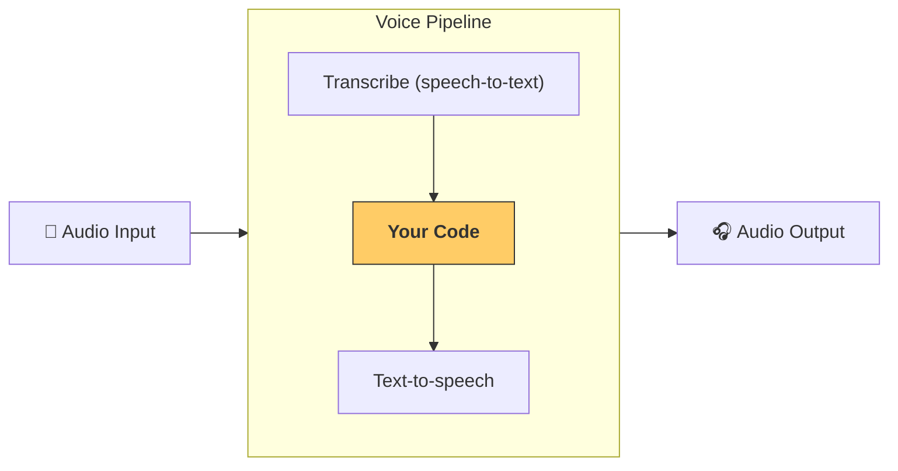

---
search:
  exclude: true
---
# パイプラインとワークフロー

[`VoicePipeline`][agents.voice.pipeline.VoicePipeline] は、エージェント型ワークフローを音声アプリに簡単に変換できるクラスです。実行するワークフローを渡すと、パイプラインが入力音声の文字起こし、音声終了の検出、適切なタイミングでのワークフローの呼び出し、ワークフロー出力の音声への変換を処理します。



## パイプラインの設定 {#configuring-a-pipeline}

パイプラインを作成するときに、次の項目を設定できます。

1. [`workflow`][agents.voice.workflow.VoiceWorkflowBase]。新しい音声が文字起こしされるたびに実行されるコードです。
2. 使用する [`speech-to-text`][agents.voice.model.STTModel] モデルと [`text-to-speech`][agents.voice.model.TTSModel] モデル
3. [`config`][agents.voice.pipeline_config.VoicePipelineConfig]。次のような項目を設定できます。
    - モデル名をモデルにマッピングできるモデルプロバイダー
    - トレーシングを無効にするかどうか、音声ファイルをアップロードするかどうか、ワークフロー名、トレース ID などを含むトレーシング
    - プロンプト、言語、使用するデータ型など、TTS モデルと STT モデルの設定

### 単一エージェントワークフローへのアプリケーションコンテキストの受け渡し {#pass-application-context-to-a-single-agent-workflow}

音声エージェント、そのツール、またはライフサイクルフックでアプリケーションの状態や依存関係が必要な場合は、[`SingleAgentVoiceWorkflow`][agents.voice.workflow.SingleAgentVoiceWorkflow] に `context` を渡します。

```python
from dataclasses import dataclass

from agents import Agent
from agents.voice import SingleAgentVoiceWorkflow, VoicePipeline


@dataclass
class VoiceContext:
    user_id: str


agent = Agent[VoiceContext](name="Voice assistant")
workflow = SingleAgentVoiceWorkflow(
    agent,
    context=VoiceContext(user_id="user-123"),
)
pipeline = VoicePipeline(workflow=workflow)
```

ワークフローは、後続の文字起こしターンを含め、開始するすべてのエージェント実行に同じコンテキストオブジェクトを渡します。ツールとライフサイクルフックは、[`RunContextWrapper.context`][agents.run_context.RunContextWrapper.context] を介してそのコンテキストを受け取ります。コンテキストはアプリケーション内に保持され、モデルには送信されません。型指定とライフサイクルに関するガイダンスについては、[コンテキスト管理](../context.md)を参照してください。

### OpenAI 音声モデルの設定 {#configure-openai-speech-models}

デフォルトの OpenAI 音声モデルを設定するには、`VoicePipelineConfig` を介して [`STTModelSettings`][agents.voice.model.STTModelSettings] と [`TTSModelSettings`][agents.voice.model.TTSModelSettings] を渡します。

```python
from agents.voice import STTModelSettings, TTSModelSettings, VoicePipeline, VoicePipelineConfig

config = VoicePipelineConfig(
    stt_settings=STTModelSettings(
        language="en",
        prompt="A customer support call about product AC-42.",
    ),
    tts_settings=TTSModelSettings(
        voice="marin",
    ),
)
pipeline = VoicePipeline(workflow=workflow, config=config)
```

完全な音声入力の場合、`STTModelSettings.language` と `prompt` が文字起こしリクエストに渡されます。[`StreamedAudioInput`][agents.voice.input.StreamedAudioInput] の場合、WebSocket セッションの設定時に、OpenAI の文字起こしセッションは `language`、`prompt`、およびストリーミング専用の `languages` と `keywords` の設定も受け取ります。`gpt-transcribe` と `gpt-live-transcribe` では、想定される入力言語のリストである `languages` と、音声に含まれる可能性があるリテラル語句のリストである `keywords` を使用します。`languages` が設定されている場合は、`language` より優先されます。それ以外の場合、これら 2 つのモデルは、SDK の単一の `language` 値を 1 要素の `languages` リストとして受け取ります。その他の文字起こしモデルには、引き続き単数形の `language` フィールドが渡されます。API でサポートされている言語コードを使用し、`prompt` には文字起こしタスクを改めて記述するのではなく、録音内容や録音環境を記述してください。キーワードは文字起こしのヒントであり、必須の出力ではありません。OpenAI の[文字起こしコンテキストガイド](https://developers.openai.com/api/docs/guides/transcription#improve-transcription-quality)を参照してください。

想定される言語を切り替えられるストリーミング文字起こしでは、ストリーミング専用フィールドを明示的に設定します。

```python
config = VoicePipelineConfig(
    stt_settings=STTModelSettings(
        languages=["en", "es"],
        keywords=["AC-42", "Agents SDK"],
        prompt="A customer support call about product AC-42.",
    ),
)
```

`TTSModelSettings.dtype` は、`np.int16`、`np.float32`、`"int16"`、`"float32"`、および `"f4"` などのエイリアスを含む、ネイティブな `int16` または `float32` に解決される NumPy dtype 表記を受け付けます。その他の dtype や非ネイティブのバイトオーダーを指定すると、パイプラインがストリーミングされた TTS 音声を変換する際に [`UserError`][agents.exceptions.UserError] が発生します。

組み込みでサポートされている `TTSModelSettings.voice` の値は、`alloy`、`ash`、`ballad`、`coral`、`echo`、`fable`、`onyx`、`nova`、`sage`、`shimmer`、`verse`、`marin`、`cedar` です。利用できる音声は、選択したテキスト読み上げモデルによって異なります。モデルごとの最新の対応状況については、OpenAI の[音声オプション](https://developers.openai.com/api/docs/guides/text-to-speech#voice-options)を参照してください。OpenAI のカスタム音声を利用できる組織は、代わりにカスタム音声 ID を渡せます。

```python
config = VoicePipelineConfig(
    tts_settings=TTSModelSettings(
        voice={"id": "voice_123abc"},
    ),
)
```

カスタム音声は対象となるお客様のみ利用でき、使用前に OpenAI API を通じて作成する必要があります。アクセス、同意、作成の要件については、OpenAI の[カスタム音声ガイド](https://developers.openai.com/api/docs/guides/text-to-speech#custom-voices)を参照してください。

[`OpenAIVoiceModelProvider`][agents.voice.models.openai_model_provider.OpenAIVoiceModelProvider] は、非ストリーミングの文字起こしリクエスト、TTS リクエスト、ストリーミング STT 接続に、設定された `AsyncOpenAI` クライアントを使用します。ストリーミング STT の WebSocket 接続では、エンドポイント、認証とデフォルトヘッダー、およびデフォルトのクエリパラメーターがそのクライアントから取得されます。プロバイダーの所有権と優先順位の規則については、[API キーとクライアント](../config.md#api-keys-and-clients)を参照してください。

## パイプラインの実行 {#running-a-pipeline}

[`run()`][agents.voice.pipeline.VoicePipeline.run] メソッドを使用してパイプラインを実行できます。このメソッドでは、次の 2 つの形式で音声入力を渡せます。

1. [`AudioInput`][agents.voice.input.AudioInput] は、完全な音声入力があり、それに対する実行結果のみを生成する場合に使用します。話者が話し終えたタイミングを検出する必要がない場合に便利です。たとえば、事前に録音された音声がある場合や、ユーザーが話し終えたタイミングが明確なプッシュ・トゥ・トークアプリなどです。
2. [`StreamedAudioInput`][agents.voice.input.StreamedAudioInput] は、ユーザーが話し終えたタイミングを検出する必要がある場合に使用します。検出された音声チャンクを順次送信でき、音声パイプラインは「アクティビティ検出」と呼ばれるプロセスを通じて、適切なタイミングでエージェントワークフローを自動的に実行します。

## 実行結果 {#results}

音声パイプラインの実行結果は [`StreamedAudioResult`][agents.voice.result.StreamedAudioResult] です。これは、イベントの発生に応じてストリーミングできるオブジェクトです。[`VoiceStreamEvent`][agents.voice.events.VoiceStreamEvent] には、次のようないくつかの種類があります。

1. [`VoiceStreamEventAudio`][agents.voice.events.VoiceStreamEventAudio]。音声チャンクが含まれます。
2. [`VoiceStreamEventLifecycle`][agents.voice.events.VoiceStreamEventLifecycle]。ターンの開始や終了などのライフサイクルイベントを通知します。
3. [`VoiceStreamEventError`][agents.voice.events.VoiceStreamEventError]。エラーイベントです。

アプリケーションが [`StreamedAudioResult.stream()`][agents.voice.result.StreamedAudioResult.stream] を消費している間に、パイプラインを終了させるエラーが発生します。それ以外は正常に実行された後、音声テキスト変換の文字起こしセッションを閉じられない場合、ストリームは無期限に待機するのではなく、その終了エラーを発生させます。ターンがすでに失敗しており、文字起こしセッションの終了にも失敗した場合、ストリームは元のターンエラーを主要なエラーとして保持します。

```python
result = await pipeline.run(input)

async for event in result.stream():
    if event.type == "voice_stream_event_audio":
        # play audio
        pass
    elif event.type == "voice_stream_event_lifecycle":
        # lifecycle
        pass
    elif event.type == "voice_stream_event_error":
        # error
        pass
```

## ベストプラクティス {#best-practices}

### 割り込み {#interruptions}

Agents SDK は現在、[`StreamedAudioInput`][agents.voice.input.StreamedAudioInput] に対する組み込みの割り込み処理を提供していません。代わりに、検出された各ターンによってワークフローが個別に実行されます。アプリケーション内で割り込みを処理する場合は、[`VoiceStreamEventLifecycle`][agents.voice.events.VoiceStreamEventLifecycle] イベントをリッスンできます。`turn_started` は、新しいターンが文字起こしされ、処理が開始されることを示します。`turn_ended` は、該当するターンのすべての音声が送信された後に発生します。これらのイベントを使用して、モデルがターンを開始したときに話者のマイクをミュートし、アプリケーションがそのターンに関連するすべての音声の再生を終えた後にミュートを解除できます。