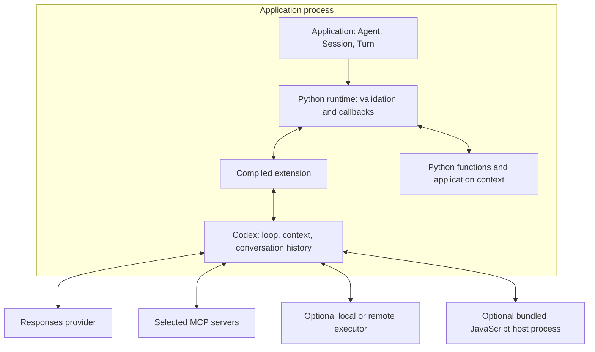
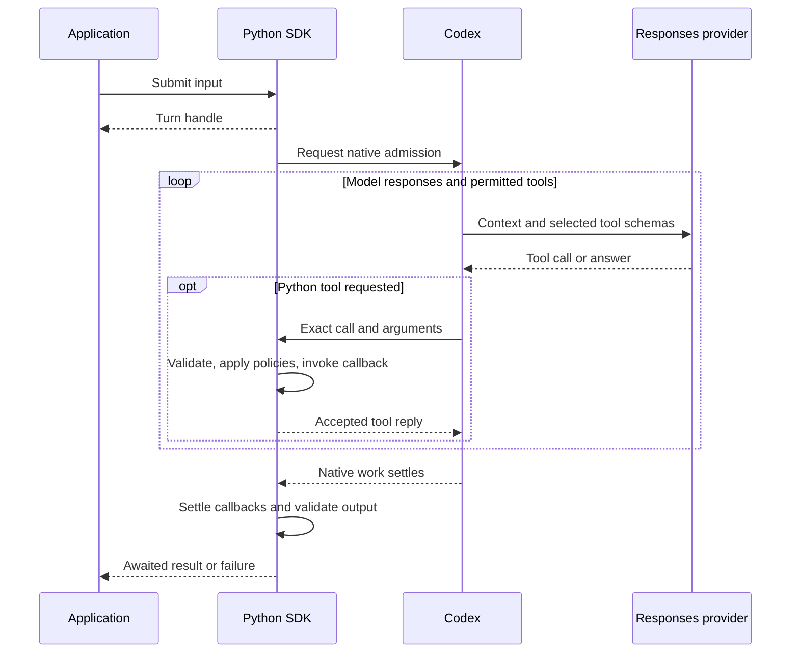

# Core concepts

An `Agent` defines instructions and tools. A `Session` keeps one conversation open, and a `Turn` represents one submitted task. Your application uses these objects to start work, read results, and manage the conversation.

The SDK uses the embedded Codex runtime to request model responses, call permitted tools, and record results. Your Python code supplies the application logic, functions, and policies. The term **Codex harness** refers to this runtime around the model.

The native v1 API is under development. These guides use `0.24.0-alpha.7` as the installation baseline and identify features that need a newer development build. Use the [guides for your installed build](versions.md). The [v0 comparison](#compare-with-v0240) below uses stable v0.24.0.

## Agent, Session, and Turn

| Object | Role |
| --- | --- |
| `Agent` | Reusable, immutable instructions, tools, model settings, and output defaults. Declaring it starts no model request or tool execution. |
| `Session` | One live conversation, its callbacks, and native resources. Open it with `async with`. |
| `Turn` | A handle for submitted work, which can include several model requests and tool calls. Await `turn.get_result()`. |
| `Completed` | The completed Turn's output in `final_output`, plus available usage information. |

Choose the entry point for your task:

- For one answer, `await agent.run(input)` opens a Session, waits for the result, and closes the Session.
- For follow-up messages or streaming, keep [an explicit Session](sessions.md) open and await each Turn's result.
- In synchronous code, use `agent.run_sync(input)` outside an existing event loop.

Reusing the Agent alone does not reuse a conversation. Configure [`output_type`](outputs.md#return-a-typed-result) when you need the answer as a validated Python value.

## Choose your next task

Start with the objects above, then add the features your application needs:

| Task | Guide |
| --- | --- |
| Give tools access to application data | [Application context](tools.md#application-context) |
| Send follow-up messages in one conversation | [Conversations](sessions.md) |
| Display progress while work runs | [Streaming and events](streaming.md) |
| Return a validated Python value | [Structured output](outputs.md) |
| Keep history after a Session closes | [Storage choices](state.md#choose-how-to-store-a-conversation) |

The rest of this page explains runtime ownership and optional controls. You do not need an executor, child agents, or custom callbacks for a basic Python-tool agent.

## What you can build

An agent investigating a failed build can read source files and run a test in a selected workspace. It can query your build service through a function, then use the results to explain the failure. Codex coordinates the requests and tool results within that conversation. Your application can display progress, restrict tools, and stop the work through the same Session.

Choose the capabilities the task needs:

- An [Environment](execution.md) supplies local or remote command and file operations with configured permissions.
- [Model Context Protocol (MCP) tools](mcp.md) can add access to a build service or issue tracker.
- [Native children](delegation.md) can investigate independent questions using shared selected tools and policies. They require a compatible explicit model and Environment.
- [Programmatic tool calling](configuration.md#programmatic-tool-calling) lets model-generated JavaScript coordinate declared tools in a separate bundled V8 host process. Your functions remain Python.

Ordinary Python function tools run in your worker without an Environment. The design puts the loop and native tools in Codex and keeps application integration in Python. You can use it for coding workflows or assistants that work with documents and business systems.

## What runs in your worker

The SDK runs inside your application process, also called a worker. The Python layer manages Sessions, validates values, and invokes your callbacks. A compiled extension connects it to the embedded Codex runtime. Both ship in the `openai-agents` distribution.

By default, `NativeProvider` sends requests through Codex's client to a Responses endpoint. Follow the [provider checks](providers.md) for custom endpoints; text compatibility alone does not establish tool or WebSocket support. Matching development builds also support [application-owned model clients](models.md#use-an-application-owned-model-client).

Async Python callbacks run in the application event loop; synchronous callbacks run in SDK-owned worker threads. Executor permissions apply to executor operations. Your Python callbacks run with your application's permissions, and MCP servers have their own execution environments. See [tool execution](tools.md#execution-and-cancellation) and the [source ownership map](https://github.com/openai/openai-agents-python/blob/62a72bbcd78a7412713e33978f948d2479c33c19/packages/codex/MAINTAINING.md#runtime-ownership).

## Follow a Turn

`Session.submit()` returns a Turn handle before Codex accepts the work for execution. Await `turn.get_result()` to receive the result or an error. A busy Session rejects another submission by default; use [queueing or steering](sessions.md#queue-or-steer-active-work) to submit work while a Turn is active.

Use [passive observations](streaming.md#stream-observations) to display progress. Observation streams can have gaps, so await the Turn result to determine completion. A `TurnFinished` observation describes one native step; accepted steering can continue the logical Turn. Independent child agents can also remain active after the primary agent returns a result.

Answer approvals, forms, and manual calls through [live interaction handles](approvals.md), not passive events. Cancelling a result waiter or closing an observation cursor leaves work running. Use [Turn cancellation or Session closure](sessions.md#interrupt-work) to stop owned work and join cleanup. Cancellation cannot undo external effects, and a running synchronous callback cannot be forcibly stopped.

Configure [native telemetry](observability.md) separately before opening the first Session, then shut it down after Sessions close. Diagnose failures using traces, retained history, and application effect records together.

## Control tools, requests, and approvals

Add these controls when the default loop needs application-specific decisions. Start with one extension point and keep its scope explicit.

| Extension point | Scope |
| --- | --- |
| [Agent and Session configuration](configuration.md#choose-tools-and-workspace-access) | Bind opening tools, instructions, provider, context, and executor policy. |
| [`transform_context`](configuration.md#choose-a-model-context-hook) | Replace model input for roots, children, compaction, or output repair. Canonical history remains unchanged. |
| [`before_step`](sessions.md#select-tools-before-each-model-step) | Select among available tools for the next model step or return `StopTurn`; cannot add capabilities. |
| [`prepare_request`](configuration.md#edit-the-next-sampling-request) | Edit a copy of the next model request, within its supported feature profile. Tool routing, validators, and approval policies still apply. |
| [Function `before` and `after`](tools.md#execution-and-cancellation) | Allow, deny, or replace validated arguments before execution; transform the reply afterward. |
| [Live interactions](approvals.md) | Reply to an exact pending call, approval, or form. |
| [Observations](streaming.md#stream-observations) | Read progress without controlling execution. |

**Canonical history** is Codex's accepted conversation record. The **model request** contains the instructions, input, and tool descriptions prepared for one model call; editing that copy does not rewrite history. An application-supplied [compaction summary](state.md#supply-a-trusted-summary) can change future model context while preserving the record.

Application [`context`](tools.md#application-context) holds Python objects such as a database client. The SDK excludes `ToolContext` from the model's tool schema. Returning context data from a tool makes that data model-visible. A policy can restrict a callback's arguments or reply, but changing the reply cannot undo an effect already performed.

## Retain conversations and recover effects

An ordinary Session lives in memory. Choose [storage](state.md#choose-how-to-store-a-conversation) before opening it. Portable `SessionState` captures eligible idle conversations or supported settled manual requests. Restore requires a matching Codex revision, compatible tools, and current callbacks, credentials, context, and permissions. Workspace files and live processes do not transfer.

Use the [storage comparison](state.md#choose-how-to-store-a-conversation) to choose native local profiles, an application database, or portable checkpoints. Each choice supports a different set of tools and recovery operations.

If a process stops after an external action but before its result is recorded, history cannot establish whether the action occurred. Check application records and [reconcile unknown effects](state.md#recover-after-interruption) before continuing. Use durable business operation IDs to deduplicate actions; storage does not guarantee exactly-once effects.

## Compare with v0.24.0

The [stable v0.24.0 SDK](https://github.com/openai/openai-agents-python/tree/17d994bd3045dae71acda676a4ef4762ed8ecd94) already provides model/tool loops, Sessions, and resumable runs. Native execution changes their ownership and contracts.

| Concern | v0.24.0 | Native API |
| --- | --- | --- |
| Loop | Python `Runner` calls a Python `Model`, executes tools or handoffs, and repeats. | Embedded Codex coordinates model turns and permitted tools. |
| Session | History-store protocol used by the runner | Live conversation and resource owner; storage is separate |
| Run entry | `Runner.run(agent, input)` | `agent.run(input)` or Session submission and Turn completion |
| Model integration | Python `Model` and `ModelProvider` | `NativeProvider` with a compatible Responses endpoint, or an application-model adapter in matching development builds |
| Saved work | Session history and `RunState` | Native checkpoints or configured storage, with their own restore contracts |

You can keep using v0. When upgrading, prefer a direct port to native `Agent`, `Session`, and `Turn`. The [migration guide](https://github.com/openai/openai-agents-python/blob/feat/codex-harness/MIGRATION.md) maps the APIs and provides validation steps and a coding-agent brief. Port tools, policies, events, and state handling together; an import change alone does not convert a workflow or its saved conversations.

Use **classic** only when a workflow needs the new package before it can complete the native port. `agents.classic` keeps the Python loop with explicit classic imports. Keep its agents, tools, runner, and state together, and start fresh native conversations as you port workflows. See the [classic contract](https://github.com/openai/openai-agents-python/blob/feat/codex-harness/CLASSIC.md) for the compatibility baseline, required extras, and planned lifecycle.

Classic requires `0.24.0-alpha.7` or later. Its extras retain native platform requirements. For a new native application, check [installation](installation.md) and follow the [quickstart](index.md).
