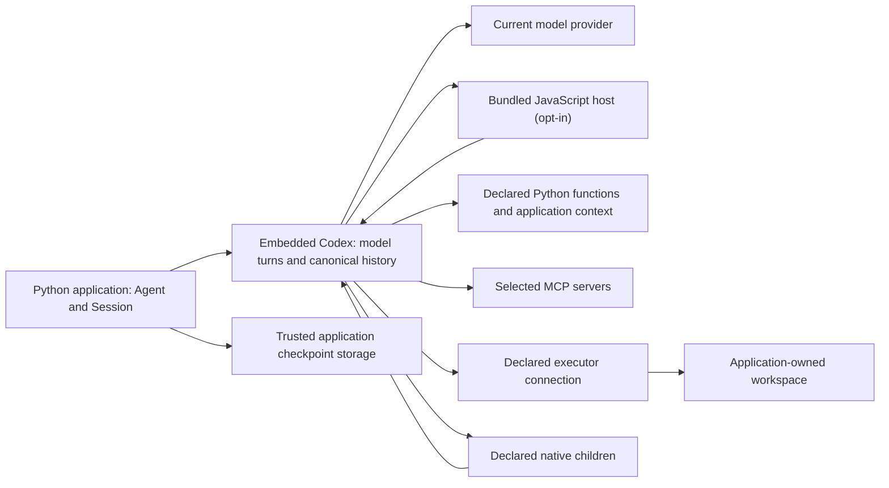

# Agent, Session and Turn

An `Agent` describes what to run. A `Session` holds a live conversation. Submitting input returns a `Turn`, which you await to get a `Completed` result.

| Object | What it owns or represents | When to use it |
| --- | --- | --- |
| `Agent` | Immutable instructions, tools and output defaults. Constructing it performs no I/O. | Reuse the declaration for independent conversations. |
| `Session` | One live native conversation, its callbacks and resources. | Keep conversation history across submissions, stream observations or save state. Open it with `async with`. |
| `Turn` | The handle for accepted work. A root handle also follows its accepted steering continuations. | Await `turn.get_result()` for completion; retain the handle to control that work. |
| `Completed` | The settled output and available usage information. | Read `final_output`, which is text by default or your configured output type. |
| Observation | A passive event, such as an output text delta. | Update a display. Events can be dropped; use the settled result for the final answer. |

A Turn can involve several model requests and tool calls. A native `TurnFinished` event is not a substitute for `turn.get_result()`. Root completion does not wait for independent native children. See [Turn lifetime and child controls](sessions.md#conversations-events-and-state) for those advanced cases.

## Choose the smallest interface you need

| Your application needs | Start with |
| --- | --- |
| One answer in an async application | `await agent.run(input)`; it opens and closes its own Session. |
| One answer in synchronous code | `agent.run_sync(input)`, outside an existing event loop. |
| Several messages in one conversation | [An explicit Session](sessions.md). |
| Text as it arrives | [A Turn observer running alongside completion](sessions.md#stream-observations). |
| A typed result | [`output_type`](configuration.md#structured-output). |
| Approval or a result supplied by your application | [An interaction handler](tools.md#answer-interactions-during-a-one-shot-run). |
| A conversation that survives Session closure | [Choose a persistence method](sessions.md#choose-how-to-store-a-conversation). |

In a notebook or async web handler, use `await`; do not call `asyncio.run()` or `run_sync()` inside that running event loop. The complete scripts in these guides use `asyncio.run(main())` because they start a new Python process.

## Keep application state and conversation state separate

Instructions and submitted input are model-facing. Tool arguments and results also enter the model conversation. Application `context` supplies Python objects to callbacks, such as an account or database client. The SDK excludes the `ToolContext` parameter from the tool schema. A tool can still expose context data by returning it, so choose its result deliberately. See the [complete context example](tools.md#application-context).

A checkpoint records conversation state. It does not transfer live Python objects, credentials or open handles. Your application supplies current callbacks, context and permissions when restoring. Follow the [save and restore rules](sessions.md#compact-save-and-restore).

## How the runtime fits

Codex runs the model loop. Python supplies declarations and callback decisions. Optional [programmatic tool calling](configuration.md#programmatic-tool-calling) lets the model generate JavaScript to coordinate tool calls. The SDK runs that code in its bundled V8-based Codex Code Mode host; your application and Python function tools remain Python. For remote file and process operations, supply an [Environment](tools.md#remote-execution). Choose the [deployment model](choosing.md) separately from these Python interfaces.
