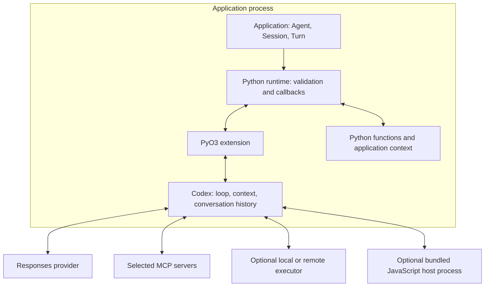
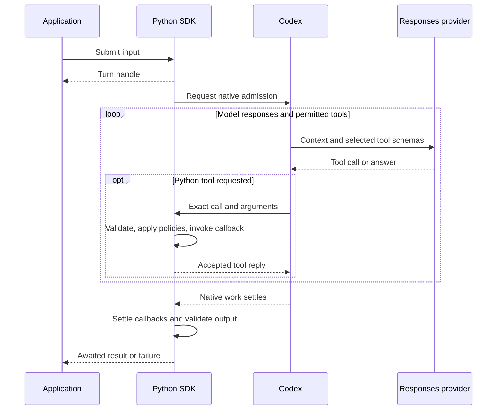

# Agents SDK architecture

The Agents SDK lets you build applications that use a model to reason and tools to act. In the native v1 design, the embedded Codex runtime coordinates the conversation: it requests model responses, routes tool calls, records results, and continues the task. You write Python for your application, functions, and policies.

The **Codex harness** is the runtime around the model. The model chooses what to do next; the harness carries out those choices through the capabilities you allow. You get Codex's execution model through a library that runs in a process you control.

The native v1 API is under development. These guides describe the development branch, including APIs added after the downloadable preview. Use the [guides for your installed build](versions.md). The [v0 comparison](#compare-with-v0240) below uses stable v0.24.0.

## What you can build

An agent investigating a failed build can read source files and run a test in a selected workspace. It can query your build service through a function, then use the results to explain the failure. Codex coordinates the requests and tool results within that conversation. Your application can display progress, restrict tools, and stop the work through the same Session.

Choose the capabilities the task needs:

- An [Environment](execution.md) supplies local or remote command and file operations with configured permissions.
- [Model Context Protocol (MCP) tools](mcp.md) can add access to a build service or issue tracker.
- [Native children](delegation.md) can investigate independent questions using shared selected tools and policies. They require a compatible explicit model and Environment.
- [Programmatic tool calling](configuration.md#programmatic-tool-calling) lets model-generated JavaScript coordinate declared tools in a separate bundled V8 host process. Your functions remain Python.

Ordinary Python function tools run in your worker without an Environment. The design puts the loop and native tools in Codex and keeps application integration in Python. You can use it for coding workflows or assistants that work with documents and business systems.

## Agent, Session, and Turn

| Object | Role |
| --- | --- |
| `Agent` | Reusable, immutable instructions, tools, model settings, and output defaults. Declaring it starts no model request or tool execution. |
| `Session` | One live conversation, its callbacks, and native resources. Open it with `async with`. |
| `Turn` | A handle for submitted work, which can include several model requests and tool calls. Await `turn.get_result()`. |
| `Completed` | Settled output in `final_output`, plus available usage information. |

For one async answer, `await agent.run(input)` opens and closes its own Session. For follow-up messages, use [an explicit Session](sessions.md), submit input, and await each Turn. Reusing the Agent alone does not reuse a conversation. Use `agent.run_sync(input)` only outside an existing event loop. Configure [`output_type`](configuration.md#structured-output) for a typed answer.

## What runs in your worker

Public `agents` imports forward to the private `_agents_codex` Python implementation. Python manages Sessions, validates values, and invokes application callbacks. The PyO3 extension connects Python to the embedded Codex Rust runtime. These components ship in one `openai-agents` distribution.

With `NativeProvider`, Codex sends Responses requests to the configured endpoint. Follow the [provider checks](providers.md) for custom endpoints; text compatibility alone does not establish tool or WebSocket support.

Async Python callbacks run in the application event loop; synchronous callbacks run in SDK-owned worker threads. Executor permissions apply to executor operations. Your Python callbacks run with your application's permissions, and MCP servers have their own execution environments. See [tool execution](tools.md#execution-and-cancellation) and the [source ownership map](https://github.com/openai/openai-agents-python/blob/62a72bbcd78a7412713e33978f948d2479c33c19/packages/codex/MAINTAINING.md#runtime-ownership).

## Follow a Turn

`Session.submit()` returns before native admission completes. A busy Session rejects another submission by default; [queueing and steering](sessions.md#queue-or-steer-active-work) are explicit choices.

Await `turn.get_result()` for completion. [Passive observations](sessions.md#stream-observations) support a display but can have gaps. A `TurnFinished` observation describes one native step; accepted steering can continue the logical Turn. Independent children can also remain active after the root result.

Answer approvals, forms, and manual calls through [live interaction handles](approvals.md), not passive events. Cancelling a result waiter or closing an observation cursor leaves work running. Use [Turn cancellation or Session closure](sessions.md#interrupt-work) to stop owned work and join cleanup. Cancellation cannot undo external effects, and a running synchronous callback cannot be forcibly stopped.

Configure [native telemetry](observability.md) separately before opening the first Session, then shut it down after Sessions close. Diagnose failures using traces, retained history, and application effect records together.

## Control tools, requests, and approvals

| Extension point | Scope |
| --- | --- |
| [Agent and Session configuration](configuration.md#choose-tools-and-workspace-access) | Bind opening tools, instructions, provider, context, and executor policy. |
| [`transform_context`](configuration.md#choose-a-model-context-hook) | Replace model input for roots, children, compaction, or output repair. Canonical history remains unchanged. |
| [`before_step`](sessions.md#select-tools-before-each-model-step) | Select among available tools for the next model step or return `StopTurn`; cannot add capabilities. |
| [`prepare_request`](configuration.md#edit-the-next-sampling-request) | Edit a copy of the next model request, within its supported feature profile. Tool routing, validators, and approval policies still apply. |
| [Function `before` and `after`](tools.md#execution-and-cancellation) | Allow, deny, or replace validated arguments before execution; transform the reply afterward. |
| [Live interactions](approvals.md) | Reply to an exact pending call, approval, or form. |
| [Observations](sessions.md#stream-observations) | Read progress without controlling execution. |

**Canonical history** is Codex's accepted conversation record. The **model request** contains the instructions, input, and tool descriptions prepared for one model call; editing that copy does not rewrite history. An application-supplied [compaction summary](state.md#supply-a-trusted-summary) can change future model context while preserving the record.

Application [`context`](tools.md#application-context) holds Python objects such as a database client. The SDK excludes `ToolContext` from the model's tool schema. Returning context data from a tool makes that data model-visible. A policy can restrict a callback's arguments or reply, but changing the reply cannot undo an effect already performed.

## Retain conversations and recover effects

An ordinary Session lives in memory. Choose [storage](state.md#choose-how-to-store-a-conversation) before opening it. Portable `SessionState` captures eligible idle conversations or supported settled manual requests. Restore requires a matching Codex revision, compatible tools, and current callbacks, credentials, context, and permissions. Workspace files and live processes do not transfer.

`LocalStorage` retains a native profile and Session ID; it cannot export portable checkpoints and rejects Code Mode on this branch. `CustomStorage` supports root conversations with automatic Python tools; it excludes MCP, workspace executors, and native children. Check [storage and capture limits](choosing.md#choose-feature-combinations) before combining capabilities.

If a process stops after an external action but before its result is recorded, history cannot establish whether the action occurred. Check application records and [reconcile unknown effects](state.md#recover-after-interruption) before continuing. Use durable business operation IDs to deduplicate actions; storage does not guarantee exactly-once effects.

## Compare with v0.24.0

The [stable v0.24.0 SDK](https://github.com/openai/openai-agents-python/tree/17d994bd3045dae71acda676a4ef4762ed8ecd94) already provides model/tool loops, Sessions, and resumable runs. Native execution changes their ownership and contracts.

| Concern | v0.24.0 | Native API |
| --- | --- | --- |
| Loop | Python `Runner` calls a Python `Model`, executes tools or handoffs, and repeats. | Embedded Codex coordinates model turns and permitted tools. |
| Session | History-store protocol used by the runner | Live conversation and resource owner; storage is separate |
| Run entry | `Runner.run(agent, input)` | `agent.run(input)` or Session submission and Turn completion |
| Model integration | Python `Model` and `ModelProvider` | `NativeProvider` and a compatible Responses endpoint |
| Saved work | Session history and `RunState` | Native checkpoints or configured storage, with their own restore contracts |

You can keep using v0. When upgrading, prefer a direct port to native `Agent`, `Session`, and `Turn`. The [migration guide](https://github.com/openai/openai-agents-python/blob/feat/codex-harness/MIGRATION.md) maps the APIs and provides validation steps and a coding-agent brief. Port tools, policies, events, and state handling together; an import change alone does not convert a workflow or its saved conversations.

Use **classic** only when a workflow needs the new package before it can complete the native port. `agents.classic` keeps the Python loop with explicit classic imports. Keep its agents, tools, runner, and state together, and start fresh native conversations as you port workflows. See the [classic contract](https://github.com/openai/openai-agents-python/blob/feat/codex-harness/CLASSIC.md) for the compatibility baseline, required extras, and planned lifecycle.

Classic requires a matching development build beyond the published preview. Its extras retain native platform requirements. For a new native application, check [installation](installation.md) and follow the [quickstart](index.md).
