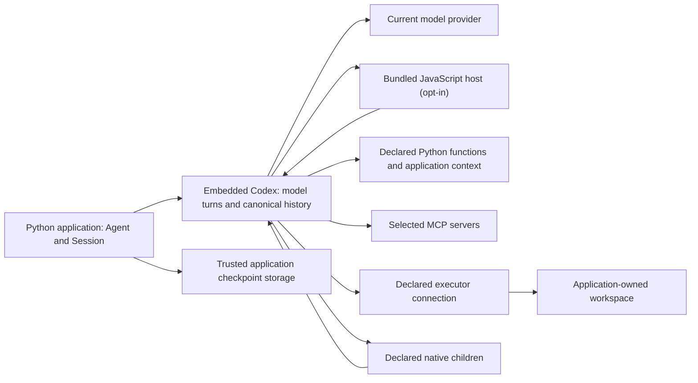

# Agent, Session and Turn

An `Agent` defines instructions and tools that you can reuse across conversations. Open a `Session` for one live conversation, then submit input to get a `Turn`. Await `turn.get_result()` to receive a `Completed` result with the final output. A Turn can include several model requests and tool calls.

| Object | What it owns or represents | When to use it |
| --- | --- | --- |
| `Agent` | Immutable instructions, tools, and output defaults. Construction does not start a model request or execute a tool. | Reuse the declaration for independent conversations. |
| `Session` | One live Codex conversation, with its callbacks and resources. | Keep conversation history across submissions, stream observations or save state. Open it with `async with`. |
| `Turn` | A handle for accepted work. A root handle also tracks work continued by accepted steering input. | Await `turn.get_result()` for completion. Keep the handle to control that work. |
| `Completed` | The completed output and available usage information. | Read `final_output`, which is text by default or your configured output type. |
| Observation | A passive event, such as an output text delta. | Update a display. Events can be dropped. Use the completed result for the final answer. |

Use `turn.get_result()` to determine completion. A native `TurnFinished` observation marks a native step ending. SDK callbacks, result validation, or accepted steering input can continue the logical Turn after that step. If you enable delegation, independent native children can still run after the root Turn finishes. See [Turn lifetime and child controls](sessions.md) for those cases.

## Choose the smallest interface you need

| Your application needs | Start with |
| --- | --- |
| One answer in an async application | `await agent.run(input)`, which opens and closes its own Session. |
| One answer in synchronous code | `agent.run_sync(input)`, outside an existing event loop. |
| Several messages in one conversation | [An explicit Session](sessions.md). |
| Text as it arrives | [A Turn observer running alongside completion](sessions.md#stream-observations). |
| A typed result | [`output_type`](configuration.md#structured-output). |
| Approval or a result supplied by your application | [An interaction handler](approvals.md#answer-interactions-during-a-one-shot-run). |
| A conversation that survives Session closure | [Choose a persistence method](state.md#choose-how-to-store-a-conversation). |

In a notebook or async web handler, use `await`; do not call `asyncio.run()` or `run_sync()` inside that running event loop. The complete scripts in these guides use `asyncio.run(main())` because they start a new Python process.

## Keep application state and conversation state separate

Conversation content includes instructions, submitted input, tool arguments, and tool results. Application `context` supplies Python objects to callbacks, such as an account or database client. The SDK excludes the `ToolContext` parameter from the tool schema. Returning context data from a tool sends that data to the model, so select the public result carefully. See the [complete context example](tools.md#application-context).

A checkpoint records conversation state. It does not transfer live Python objects, credentials, or open handles. When restoring a checkpoint, your application supplies the current callbacks, context, and permissions. Follow the [save and restore rules](state.md#save-and-restore-a-portable-checkpoint).

## How the runtime fits

Codex runs the model loop inside your application. Your Python code declares agents and tools and handles callbacks. The application owns its workers, credentials, storage, and any execution workspace.

Add these features only when the application needs them:

- [Programmatic tool calling](configuration.md#programmatic-tool-calling) lets the model generate JavaScript to coordinate tool calls. The SDK executes the JavaScript in its bundled V8-based Codex Code Mode host. Your application and function tools still run in Python.
- An [Environment](execution.md) connects file and process operations to an application-selected executor.
- [Delegation](delegation.md) lets the model start native child agents.

See [Choose how to run your agent](choosing.md) to compare this application-owned runtime with the hosted Agents API.
