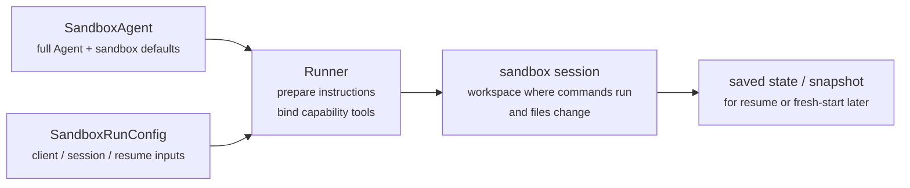
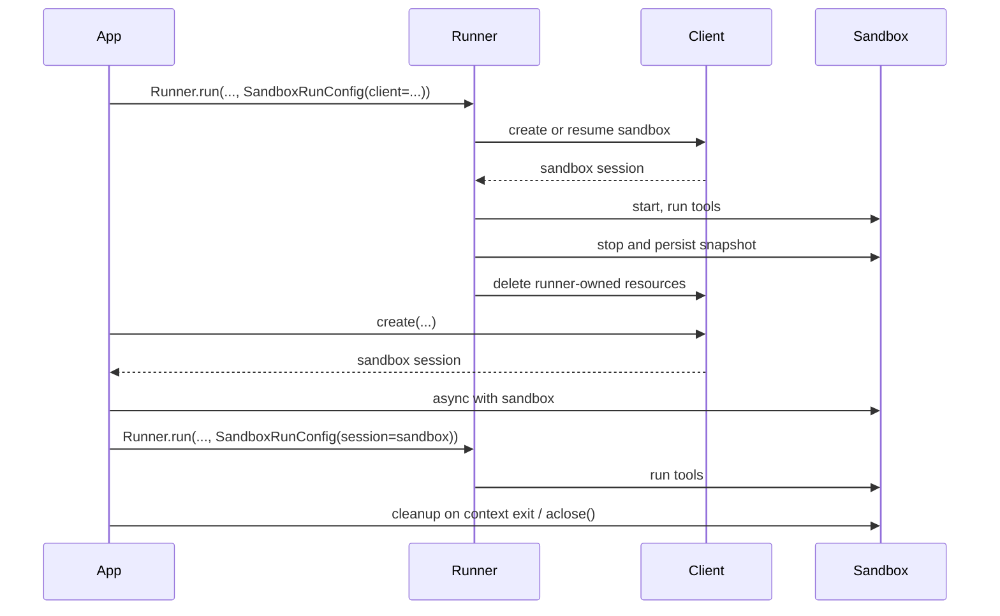

---
search:
  exclude: true
---
# 概念

现代智能体在能够操作文件系统中的真实文件时，效果最佳。**沙箱智能体**可以使用专用工具和 shell 命令来搜索和操作大型文档集、编辑文件、生成产物以及运行命令。沙箱为模型提供一个持久化工作区，智能体可以在其中代您完成工作。Agents SDK 中的沙箱智能体可帮助您轻松运行与沙箱环境配对的智能体，让您可以轻松地将正确文件放入文件系统，并编排沙箱，从而大规模地启动、停止和恢复任务。

您可以围绕智能体所需的数据定义工作区。工作区可以从 GitHub 仓库、本地文件和目录、合成任务文件、S3 或 Azure Blob Storage 等远程文件系统，以及您提供的其他沙箱输入开始构建。

<div class="sandbox-harness-image" markdown="1">


</div>

`SandboxAgent` 仍然是 `Agent`。它保留了常见的智能体接口，例如 `instructions`、`prompt`、`tools`、`handoffs`、`mcp_servers`、`model_settings`、`output_type`、安全防护措施和钩子，并且仍通过常规的 `Runner` API 运行。变化的是执行边界：

- `SandboxAgent` 定义智能体本身：常规智能体配置，以及 `default_manifest`、`base_instructions`、`run_as` 等沙箱专用默认值，还有文件系统工具、shell 访问、技能、记忆或压缩等能力。
- `Manifest` 声明全新沙箱工作区所需的初始内容和布局，包括文件、仓库、挂载和环境。
- 沙箱会话是运行命令和修改文件的实时执行环境。会话提供的隔离取决于其后端和配置。
- [`SandboxRunConfig`][agents.run_config.SandboxRunConfig] 决定本次运行如何获取该沙箱会话，例如直接注入会话、从序列化的沙箱会话状态重新连接，或通过沙箱客户端创建全新的沙箱会话。
- 保存的沙箱状态和快照可让后续运行重新连接到之前的工作，或使用保存的内容初始化全新的沙箱会话。

`Manifest` 是新会话的工作区契约，而不是每个实时沙箱的完整事实来源。一次运行的有效工作区也可以来自复用的沙箱会话、序列化的沙箱会话状态，或在运行时选择的快照。

在本页中，“沙箱会话”是指由沙箱客户端管理的实时执行环境。它不同于[会话](../sessions/index.md)中所述的 SDK 对话式 [`Session`][agents.memory.session.Session] 接口。

外层运行时仍负责审批、追踪、任务转移，以及跟踪恢复运行所需的状态。沙箱会话通过其后端管理命令和文件变更。适用哪些隔离控制措施由后端决定；会话本身并不保证操作系统级别的限制。

### 各组成部分的协作方式 {#how-the-pieces-fit-together}

沙箱运行将智能体定义与每次运行的沙箱配置结合起来。运行器会准备智能体，将其绑定到实时沙箱会话，并可保存状态供后续运行使用。



沙箱专用默认值保留在 `SandboxAgent` 上。每次运行的沙箱会话选择保留在 `SandboxRunConfig` 中。

可以将生命周期分为三个阶段：

1. 使用 `SandboxAgent`、`Manifest` 和能力来定义智能体及新工作区契约。
2. 向 `Runner` 提供一个 `SandboxRunConfig`，通过注入、恢复或创建沙箱会话来执行运行。
3. 之后从运行器管理的 `RunState`、显式的沙箱 `session_state` 或保存的工作区快照继续执行。

如果 shell 访问只是偶尔使用的一种工具，请从[工具指南](../tools.md)中的托管 shell 开始。如果工作区隔离、沙箱客户端选择或沙箱会话恢复行为属于设计的一部分，请使用沙箱智能体。

## 适用场景 {#when-to-use-them}

沙箱智能体非常适合以工作区为中心的工作流，例如：

- 编码和调试，例如为 GitHub 仓库中的问题报告编排自动修复并运行针对性测试
- 文档处理和编辑，例如从用户的财务文档中提取信息并创建已填写的税务表单草稿
- 基于文件的审查或分析，例如在回答前检查入职资料包、生成的报告或产物包
- 使用独立工作区的多智能体模式，例如为每个审查智能体或编码子智能体分配各自的工作区
- 多步骤工作区任务，例如在一次运行中修复错误，之后添加回归测试，或从快照或沙箱会话状态恢复

如果不需要访问文件或有状态、可变的文件系统，请继续使用 `Agent`。如果 shell 访问只是偶尔使用的一项能力，请添加托管 shell；如果工作区边界本身就是功能的一部分，请使用沙箱智能体。

## 沙箱客户端的选择 {#choose-a-sandbox-client}

在 macOS 或 Linux 上进行可信的本地开发，或在外部隔离环境中运行时，请使用 `UnixLocalSandboxClient`。在 Linux 上，此后端将命令作为主机进程运行，而不会额外提供操作系统级别的限制。在 macOS 上，它通过 `sandbox-exec` 应用文件系统限制，但不提供网络隔离。

默认情况下，新的 Unix 本地会话会获得相互独立的临时工作区。如果为多个会话配置相同的自定义 `Manifest.root`，这些会话将共享工作区。独立会话并不保证操作系统级别的隔离。

对于不可信命令，包括受不可信输入影响的命令，请选择经过适当配置的 `DockerSandboxClient` 或托管提供商，或提供外部隔离。在 Windows 上，请使用 Docker 或托管提供商。选择本地后端前，请参阅 [Unix 本地执行限制](clients.md#decision-guide)。

在大多数情况下，`SandboxAgent` 定义保持不变，只需在 [`SandboxRunConfig`][agents.run_config.SandboxRunConfig] 中更改沙箱客户端及其选项。有关本地、Docker、托管和远程挂载选项，请参阅[沙箱客户端](clients.md)。

## 核心组成 {#core-pieces}

<div class="sandbox-nowrap-first-column-table" markdown="1">

| 层 | 主要 SDK 组成 | 所回答的问题 |
| --- | --- | --- |
| 智能体定义 | `SandboxAgent`、`Manifest`、能力 | 将运行哪个智能体，以及它应从什么样的新会话工作区契约开始？ |
| 沙箱执行 | `SandboxRunConfig`、沙箱客户端和实时沙箱会话 | 本次运行如何获取实时沙箱会话，以及工作在哪里执行？ |
| 保存的沙箱状态 | `RunState` 沙箱载荷、`session_state` 和快照 | 此工作流如何重新连接到之前的沙箱工作，或使用保存的内容初始化全新的沙箱会话？ |

</div>

主要 SDK 组成与这些层的对应关系如下：

<div class="sandbox-nowrap-first-column-table" markdown="1">

| 组成 | 负责的内容 | 应提出的问题 |
| --- | --- | --- |
| [`SandboxAgent`][agents.sandbox.sandbox_agent.SandboxAgent] | 智能体定义 | 此智能体应执行什么操作，哪些默认值应随其一起使用？ |
| [`Manifest`][agents.sandbox.manifest.Manifest] | 新会话工作区的文件和文件夹 | 运行开始时，文件系统中应存在哪些文件和文件夹？ |
| [`Capability`][agents.sandbox.capabilities.capability.Capability] | 沙箱原生行为 | 哪些工具、指令片段或运行时行为应附加到此智能体？ |
| [`SandboxRunConfig`][agents.run_config.SandboxRunConfig] | 每次运行的沙箱客户端和沙箱会话来源 | 本次运行应注入、恢复还是创建沙箱会话？ |
| [`RunState`][agents.run_state.RunState] | 由运行器管理的已保存沙箱状态 | 我是否正在恢复之前由运行器管理的工作流，并自动延续其沙箱状态？ |
| [`SandboxRunConfig.session_state`][agents.run_config.SandboxRunConfig.session_state] | 显式序列化的沙箱会话状态 | 我是否要从已在 `RunState` 外部序列化的沙箱状态恢复？ |
| [`SandboxRunConfig.snapshot`][agents.run_config.SandboxRunConfig.snapshot] | 用于全新沙箱会话的已保存工作区内容 | 新的沙箱会话是否应从保存的文件和产物开始？ |

</div>

实用的设计顺序如下：

1. 使用 `Manifest` 定义新会话工作区契约。
2. 使用 `SandboxAgent` 定义智能体。
3. 添加内置或自定义能力。
4. 在 `RunConfig(sandbox=SandboxRunConfig(...))` 中决定每次运行应如何获取其沙箱会话。

## 沙箱运行的准备过程 {#how-a-sandbox-run-is-prepared}

在运行时，运行器会将该定义转换为由沙箱支持的具体运行：

1. 它从 `SandboxRunConfig` 解析沙箱会话。如果传入 `session=...`，则会复用该实时沙箱会话。否则，它会使用 `client=...` 创建或恢复会话。
2. 它确定本次运行的有效工作区输入。如果本次运行注入或恢复沙箱会话，则以该会话现有的沙箱状态为准。否则，运行器会从一次性清单覆盖项或 `agent.default_manifest` 开始。这就是为什么仅靠 `Manifest` 无法定义每次运行最终的实时工作区。
3. 它允许能力处理生成的清单。这样，能力就可以在准备最终智能体之前添加文件、挂载或其他限定于工作区的行为。
4. 它按固定顺序构建最终指令：SDK 的默认沙箱提示词；如果您显式覆盖，则使用 `base_instructions`；之后是 `instructions`、能力指令片段、任何远程挂载策略文本，最后是渲染后的文件系统树。
5. 它将能力工具绑定到实时沙箱会话，并通过常规的 `Runner` API 运行准备好的智能体。

沙箱不会改变轮次的含义。一个轮次仍然是一个模型步骤，而不是单个 shell 命令或沙箱操作。沙箱侧操作与轮次之间不存在固定的一一对应关系：有些工作可能始终在沙箱执行层内进行，而其他操作会返回需要另一个模型步骤的信息，例如工具结果、审批或其他类型的状态。实际使用中，只有在完成沙箱工作后，智能体运行时还需要模型再次响应时，才会消耗另一个轮次。

正因存在这些准备步骤，在设计 `SandboxAgent` 时，`default_manifest`、`instructions`、`base_instructions`、`capabilities` 和 `run_as` 才是需要重点考虑的主要沙箱专用选项。

## `SandboxAgent` 选项 {#sandboxagent-options}

除了常规的 `Agent` 字段外，还提供以下沙箱专用选项：

<div class="sandbox-nowrap-first-column-table" markdown="1">

| 选项 | 最佳用途 |
| --- | --- |
| `default_manifest` | 运行器创建的全新沙箱会话所使用的默认工作区。 |
| `instructions` | 附加在 SDK 沙箱提示词之后的其他角色、工作流和成功标准。 |
| `base_instructions` | 用于替换 SDK 沙箱提示词的高级逃生舱。 |
| `capabilities` | 应随此智能体一起使用的沙箱原生工具和行为。 |
| `run_as` | shell 命令、文件读取和补丁等面向模型的沙箱工具所使用的用户身份。 |

</div>

沙箱客户端选择、沙箱会话复用、清单覆盖和快照选择应放在 [`SandboxRunConfig`][agents.run_config.SandboxRunConfig] 中，而不是智能体上。

### `default_manifest` {#default_manifest}

`default_manifest` 是运行器为此智能体创建全新沙箱会话时使用的默认 [`Manifest`][agents.sandbox.manifest.Manifest]。请使用它指定智能体通常应从哪些文件、仓库、辅助材料、输出目录和挂载开始。

这只是默认值。运行可以使用 `SandboxRunConfig(manifest=...)` 覆盖它，而复用或恢复的沙箱会话会保留其现有工作区状态。

### `instructions` 和 `base_instructions` {#instructions-and-base_instructions}

对于应在不同提示词中持续适用的简短规则，请使用 `instructions`。在 `SandboxAgent` 中，这些指令会附加在 SDK 的沙箱基础提示词之后，因此您可以保留内置沙箱指南，同时添加自己的角色、工作流和成功标准。

只有在需要替换 SDK 沙箱基础提示词时才使用 `base_instructions`。大多数智能体不应设置它。

<div class="sandbox-nowrap-first-column-table" markdown="1">

| 放置位置 | 用途 | 示例 |
| --- | --- | --- |
| `instructions` | 智能体的稳定角色、工作流规则和成功标准。 | “检查入职文档，然后执行任务转移。”、“将最终文件写入 `output/`。” |
| `base_instructions` | 完整替换 SDK 沙箱基础提示词。 | 自定义底层沙箱包装器提示词。 |
| 用户提示词 | 本次运行的一次性请求。 | “总结此工作区。” |
| 清单中的工作区文件 | 较长的任务规范、仓库本地指令或范围明确的参考资料。 | `repo/task.md`、文档包、样本资料包。 |

</div>

`instructions` 的良好用法包括：

- [examples/sandbox/unix_local_pty.py](https://github.com/openai/openai-agents-python/blob/main/examples/sandbox/unix_local_pty.py) 在 PTY 状态至关重要时，让智能体始终处于同一个交互式进程中。
- [examples/sandbox/handoffs.py](https://github.com/openai/openai-agents-python/blob/main/examples/sandbox/handoffs.py) 禁止沙箱审查智能体在检查后直接回答用户。
- [examples/sandbox/tax_prep.py](https://github.com/openai/openai-agents-python/blob/main/examples/sandbox/tax_prep.py) 要求最终填写完成的文件实际写入 `output/`。
- [examples/sandbox/docs/coding_task.py](https://github.com/openai/openai-agents-python/blob/main/examples/sandbox/docs/coding_task.py) 固定确切的验证命令，并明确说明当 `SandboxRunConfig.cwd` 未设置时，补丁路径相对于工作区根目录。

请避免将用户的一次性任务复制到 `instructions` 中、嵌入本应放入清单的长篇参考资料、重复说明内置能力已注入的工具文档，或混入模型在运行时不需要的本地安装说明。

如果省略 `instructions`，SDK 仍会包含默认沙箱提示词。这对于底层包装器已经足够，但大多数面向用户的智能体仍应提供明确的 `instructions`。

### `capabilities` {#capabilities}

能力会将沙箱原生行为附加到 `SandboxAgent`。它们可以在运行开始前调整工作区、附加沙箱专用指令、公开绑定到实时沙箱会话的工具，以及调整该智能体的模型行为或输入处理方式。

内置能力包括：

<div class="sandbox-nowrap-first-column-table" markdown="1">

| 能力 | 添加时机 | 备注 |
| --- | --- | --- |
| `Shell` | 智能体需要 shell 访问。 | 添加 `exec_command`；当沙箱客户端支持 PTY 交互时，还会添加 `write_stdin`。 |
| `Filesystem` | 智能体需要编辑文件或检查本地图像。 | 添加 `apply_patch` 和 `view_image`；默认情况下，相对路径使用工作区根目录；配置后则使用 `SandboxRunConfig.cwd`。 |
| `Skills` | 您希望在沙箱中发现和具体化技能。 | 相较于手动挂载 `.agents` 或 `.agents/skills`，优先使用此能力；`Skills` 会为您建立技能索引并将其具体化到沙箱中。 |
| `Memory` | 后续运行应读取或生成记忆产物。 | 需要 `Shell`；在运行期间更新记忆产物还需要 `Filesystem`。 |
| `Compaction` | 长时间运行的流程需要在压缩项之后裁剪上下文。 | 调整模型采样和输入处理。 |

</div>

默认情况下，`SandboxAgent.capabilities` 使用 `Capabilities.default()`，其中包含 `Filesystem()`、`Shell()` 和 `Compaction()`。如果传入 `capabilities=[...]`，该列表会替换默认列表，因此请包含您仍希望使用的所有默认能力。

`view_image` 工具根据文件内容而不是文件扩展名识别 PNG、JPEG、GIF、WebP、BMP 和 TIFF 光栅图像。如果文件名具有光栅图像扩展名，但内容不受支持，则会被拒绝；即使文件名没有图像扩展名，只要光栅内容受支持，也可以加载。对于 `.svg` 和 `.svgz` 文件，除根据文件内容识别 SVG 标记外，该工具还保留基于文件名的兼容性。

对于技能，请根据所需的具体化方式选择来源：

- 对于较大的本地技能目录，`Skills(lazy_from=LocalDirLazySkillSource(...))` 是很好的默认选择，因为模型可以先发现索引，然后只加载所需内容。
- `LocalDirLazySkillSource(source=LocalDir(src=...))` 从运行 SDK 进程的文件系统读取内容。请传入原始的主机侧技能目录，而不是仅存在于沙箱镜像或工作区中的路径。
- 对于希望预先暂存的小型本地包，`Skills(from_=LocalDir(src=...))` 更合适。
- 如果技能本身应来自仓库，`Skills(from_=GitRepo(repo=..., ref=...))` 是合适的选择。

`LocalDir.src` 是 SDK 主机上的源路径。`skills_path` 是调用 `load_skill` 时在沙箱工作区内暂存技能的相对目标路径。

如果技能已存储在类似 `.agents/skills/<name>/SKILL.md` 的磁盘路径下，请让 `LocalDir(...)` 指向该源根目录，并仍使用 `Skills(...)` 将其公开。除非现有工作区契约依赖不同的沙箱内布局，否则请保留默认的 `skills_path=".agents"`。

当内置能力适用时，请优先使用它们。只有在需要内置能力未涵盖的沙箱专用工具或指令接口时，才应编写自定义能力。

## 概念 {#concepts_1}

### 清单 {#manifest}

[`Manifest`][agents.sandbox.manifest.Manifest] 描述全新沙箱会话的工作区。它可以设置工作区 `root`、声明文件和目录、复制本地文件、克隆 Git 仓库、附加远程存储挂载、设置环境变量、定义用户或组，以及授予对工作区外特定绝对路径的访问权限。

清单条目路径相对于工作区。它们不能是绝对路径，也不能使用 `..` 逃逸工作区，从而使工作区契约可以跨本地、Docker 和托管客户端移植。

对于智能体开始工作前所需的材料，请使用清单条目：

<div class="sandbox-nowrap-first-column-table" markdown="1">

| 清单条目 | 用途 |
| --- | --- |
| `File`、`Dir` | 小型合成输入、辅助文件或输出目录。 |
| `LocalFile`、`LocalDir` | 应具体化到沙箱中的主机文件或目录。 |
| `GitRepo` | 应提取到工作区中的仓库。 |
| `S3Mount`、`GCSMount`、`R2Mount`、`AzureBlobMount`、`BoxMount`、`S3FilesMount` 等挂载 | 应在沙箱内呈现的外部存储。 |

</div>

`GitRepo` 要求在仓库具体化所在的沙箱中，`PATH` 上存在 `git` 可执行文件。对于 `UnixLocalSandboxClient`，请在本地计算机上安装 Git。对于 Docker 或托管沙箱客户端，请先在沙箱镜像或环境中包含 Git，再应用清单。安装 Python SDK 不会安装 Git。

`Dir` 会根据合成子项在沙箱工作区内创建目录，或将其用作输出位置；它不会从主机文件系统读取内容。如果需要将现有主机目录复制到沙箱工作区，请使用 `LocalDir`。

默认情况下，`LocalFile.src` 和 `LocalDir.src` 相对于 SDK 进程的工作目录解析。除非源位于 `extra_path_grants` 覆盖的范围内，否则必须处于该基准目录之下。这样可确保本地源具体化与沙箱清单的其他部分处于相同的主机路径信任边界内。

挂载条目描述要公开的存储，挂载策略则描述沙箱后端如何附加该存储。有关挂载选项和提供商支持，请参阅[沙箱客户端](clients.md#mounts-and-remote-storage)。

良好的清单设计通常意味着保持工作区契约精简，将较长的任务步骤放入 `repo/task.md` 等工作区文件，并在指令中使用相对工作区路径，例如 `repo/task.md` 或 `output/report.md`。如果智能体使用 `Filesystem` 能力的 `apply_patch` 工具编辑文件，请记住，补丁路径默认使用沙箱工作区根目录，配置后则使用 `SandboxRunConfig.cwd`；它们不使用 shell 的 `workdir`。

仅当智能体需要工作区外的具体绝对路径，或清单需要复制 SDK 进程工作目录之外的可信本地源时，才使用 `extra_path_grants`。示例包括用于临时工具输出的 `/tmp`、用于只读运行时的 `/opt/toolchain`，或应具体化到沙箱中的已生成技能目录。授权适用于本地源具体化和 SDK 文件 API。当后端可以强制执行文件系统策略时，它也适用于 shell 执行：

```python
from agents.sandbox import Manifest, SandboxPathGrant

manifest = Manifest(
    extra_path_grants=(
        SandboxPathGrant(path="/tmp"),
        SandboxPathGrant(path="/opt/toolchain", read_only=True),
    ),
)
```

当 Docker 应将不同的主机绝对路径绑定挂载到容器内的绝对 POSIX `path` 时，请设置 `host_path`。`UnixLocalSandboxClient` 仅支持两个路径相同的纯路径授权，并拒绝 `host_path`。对于沙箱不应修改的主机数据，请使用 `read_only=True`；如果复制即可满足需求，请使用 `LocalFile` 或 `LocalDir`。

Unix 本地路径授权用于管理哪些主机源可以复制到工作区，以及 SDK 文件 API 可以访问哪些路径。`read_only=True` 可阻止 SDK 文件 API 写入已授权路径。在 Linux 上，这些设置不会限制任意 shell 命令：即使主机路径未获得任何授权，只要进程权限和任何外部隔离允许，命令仍可访问该路径。macOS 文件系统配置文件和 Docker 绑定挂载会将各自的授权限制应用于命令。

请将包含 `extra_path_grants` 的清单视为可信配置。除非应用已批准这些主机路径，否则不要从模型输出或其他不可信载荷加载授权。

快照和 `persist_workspace()` 仍然只包含工作区根目录。额外授权的路径属于运行时访问权限，而非持久工作区状态。

### 权限 {#permissions}

`Permissions` 控制清单条目的文件系统权限。它针对的是沙箱具体化的文件，而不是模型权限、审批策略或 API 凭据。

默认情况下，清单条目允许所有者读取、写入和执行，并允许组和其他用户读取和执行。如果暂存文件应为私有、只读或可执行，请覆盖此设置：

```python
from agents.sandbox import FileMode, Permissions
from agents.sandbox.entries import File

private_notes = File(
    content=b"internal notes",
    permissions=Permissions(
        owner=FileMode.READ | FileMode.WRITE,
        group=FileMode.NONE,
        other=FileMode.NONE,
    ),
)
```

`Permissions` 分别存储所有者、组和其他用户的权限位，以及条目是否为目录。您可以直接构建它，也可以使用 `Permissions.from_str(...)` 从模式字符串解析，或使用 `Permissions.from_mode(...)` 从操作系统模式派生。

用户是可以在沙箱中执行工作的身份。如果希望某个身份存在于沙箱中，请将 `User` 添加到清单中；然后，当 shell 命令、文件读取和补丁等面向模型的沙箱工具应以该用户身份运行时，设置 `SandboxAgent.run_as`。如果 `run_as` 指向清单中尚不存在的用户，运行器会自动将其添加到有效清单中。

```python
from agents import Runner
from agents.run import RunConfig
from agents.sandbox import FileMode, Manifest, Permissions, SandboxAgent, SandboxRunConfig, User
from agents.sandbox.entries import Dir, LocalDir
from agents.sandbox.sandboxes.unix_local import UnixLocalSandboxClient

analyst = User(name="analyst")

agent = SandboxAgent(
    name="Dataroom analyst",
    instructions="Review the files in `dataroom/` and write findings to `output/`.",
    default_manifest=Manifest(
        # Declare the sandbox user so manifest entries can grant access to it.
        users=[analyst],
        entries={
            "dataroom": LocalDir(
                src="./dataroom",
                # Let the analyst traverse and read the mounted dataroom, but not edit it.
                group=analyst,
                permissions=Permissions(
                    owner=FileMode.READ | FileMode.EXEC,
                    group=FileMode.READ | FileMode.EXEC,
                    other=FileMode.NONE,
                ),
            ),
            "output": Dir(
                # Give the analyst a writable scratch/output directory for artifacts.
                group=analyst,
                permissions=Permissions(
                    owner=FileMode.ALL,
                    group=FileMode.ALL,
                    other=FileMode.NONE,
                ),
            ),
        },
    ),
    # Run model-facing sandbox actions as this user, so those permissions apply.
    run_as=analyst,
)

result = await Runner.run(
    agent,
    "Summarize the contracts and call out renewal dates.",
    run_config=RunConfig(
        sandbox=SandboxRunConfig(client=UnixLocalSandboxClient()),
    ),
)
```

如果还需要文件级别的共享规则，请将用户与清单组和条目 `group` 元数据结合使用。`run_as` 用户控制由谁执行沙箱原生操作；在沙箱具体化工作区之后，`Permissions` 控制该用户可以读取、写入或执行哪些文件。

### SnapshotSpec {#snapshotspec}

`SnapshotSpec` 告诉全新的沙箱会话应从何处恢复已保存的工作区内容，以及将内容持久化回何处。它是沙箱工作区的快照策略，而 `session_state` 是用于恢复特定沙箱后端的序列化连接状态。

使用 `LocalSnapshotSpec` 创建本地持久快照；当应用提供远程快照客户端时，请使用 `RemoteSnapshotSpec`。如果无法设置本地快照，则会使用无操作快照作为回退；不希望持久化工作区快照的高级调用方也可以显式使用这种快照。

```python
from pathlib import Path

from agents.run import RunConfig
from agents.sandbox import LocalSnapshotSpec, SandboxRunConfig
from agents.sandbox.sandboxes.unix_local import UnixLocalSandboxClient

run_config = RunConfig(
    sandbox=SandboxRunConfig(
        client=UnixLocalSandboxClient(),
        snapshot=LocalSnapshotSpec(base_path=Path("/tmp/my-sandbox-snapshots")),
    )
)
```

当运行器创建全新的沙箱会话时，沙箱客户端会为该会话构建快照实例。启动时，如果快照可恢复，沙箱会先恢复已保存的工作区内容，再继续运行。清理时，运行器所有的沙箱会话会归档工作区，并通过快照将其持久化。

如果省略 `snapshot`，运行时会在条件允许时尝试使用默认的本地快照位置。如果无法完成设置，则会回退到无操作快照。挂载路径和临时路径不会作为持久工作区内容复制到快照中。

### 沙箱生命周期 {#sandbox-lifecycle}

生命周期有两种模式：**SDK 所有**和**开发者所有**。

<div class="sandbox-lifecycle-diagram" markdown="1">



</div>

如果沙箱只需在一次运行期间存在，请使用 SDK 所有的生命周期。传入 `client`，还可选择传入 `manifest` 和 `snapshot`，以及所需的任何客户端 `options`；运行器会创建或恢复沙箱、启动沙箱、运行智能体、持久化由快照支持的工作区状态、结束沙箱会话，并让客户端清理由运行器所有的资源。

```python
result = await Runner.run(
    agent,
    "Inspect the workspace and summarize what changed.",
    run_config=RunConfig(
        sandbox=SandboxRunConfig(client=UnixLocalSandboxClient()),
    ),
)
```

如果希望提前创建沙箱、在多次运行间复用同一个实时沙箱、在运行后检查文件、通过自行创建的沙箱进行流式传输，或精确决定清理时机，请使用开发者所有的生命周期。传入 `session=...` 会让运行器使用该实时沙箱，但不会替您关闭它。

```python
sandbox = await client.create(manifest=agent.default_manifest)

async with sandbox:
    run_config = RunConfig(sandbox=SandboxRunConfig(session=sandbox))
    await Runner.run(agent, "Analyze the files.", run_config=run_config)
    await Runner.run(agent, "Write the final report.", run_config=run_config)
```

通常应使用上下文管理器：它会在进入时启动沙箱，并在退出时执行会话清理生命周期。如果应用无法使用上下文管理器，请直接调用生命周期方法：

```python
sandbox = await client.create(
    manifest=agent.default_manifest,
    snapshot=LocalSnapshotSpec(base_path=Path("/tmp/my-sandbox-snapshots")),
)
try:
    await sandbox.start()
    await Runner.run(
        agent,
        "Analyze the files.",
        run_config=RunConfig(sandbox=SandboxRunConfig(session=sandbox)),
    )
    # Persist a checkpoint of the live workspace before doing more work.
    # `aclose()` also calls `stop()`, so this is only needed for an explicit mid-lifecycle save.
    await sandbox.stop()
finally:
    await sandbox.aclose()
```

`stop()` 只持久化由快照支持的工作区内容；它不会销毁沙箱。`aclose()` 是完整的会话清理路径：它运行停止前钩子、调用 `stop()`、关闭沙箱资源，并关闭会话作用域的依赖项。

## `SandboxRunConfig` 选项 {#sandboxrunconfig-options}

[`SandboxRunConfig`][agents.run_config.SandboxRunConfig] 保存每次运行的选项，用于决定沙箱会话的来源以及全新会话的初始化方式。

### 沙箱来源 {#sandbox-source}

以下选项决定运行器应复用、恢复还是创建沙箱会话：

<div class="sandbox-nowrap-first-column-table" markdown="1">

| 选项 | 适用场景 | 备注 |
| --- | --- | --- |
| `client` | 希望运行器替您创建、恢复和清理沙箱会话。 | 除非提供实时沙箱 `session`，否则此项为必需。 |
| `session` | 您已自行创建实时沙箱会话。 | 调用方负责生命周期；运行器会复用该实时沙箱会话。 |
| `session_state` | 您拥有序列化的沙箱会话状态，但没有实时沙箱会话对象。 | 需要 `client`；运行器会从该显式状态恢复，并负责已恢复会话的生命周期。 |

</div>

实际使用中，运行器按以下顺序解析沙箱会话：

1. 如果注入 `run_config.sandbox.session`，则会直接复用该实时沙箱会话。
2. 否则，如果本次运行从 `RunState` 恢复，则会恢复其中保存的沙箱会话状态。
3. 否则，如果传入 `run_config.sandbox.session_state`，运行器会从该显式序列化的沙箱会话状态恢复。
4. 否则，运行器会创建全新的沙箱会话。对于该全新会话，如果提供了 `run_config.sandbox.manifest`，则使用它；否则使用 `agent.default_manifest`。

### 新会话输入 {#fresh-session-inputs}

以下选项仅在运行器创建全新沙箱会话时生效：

<div class="sandbox-nowrap-first-column-table" markdown="1">

| 选项 | 适用场景 | 备注 |
| --- | --- | --- |
| `manifest` | 希望一次性覆盖新会话工作区。 | 省略时回退到 `agent.default_manifest`。 |
| `snapshot` | 全新的沙箱会话应从快照初始化。 | 适用于类似恢复的流程或远程快照客户端。 |
| `options` | 沙箱客户端需要创建时选项。 | 常用于 Docker 镜像、Modal 应用名称、E2B 模板、超时和类似的客户端专用设置。 |

</div>

### 面向模型的工作目录 {#model-facing-working-directory}

当多次运行应共享一个沙箱会话，但在不同子目录中工作时，请将 `cwd` 设置为 POSIX 格式、相对于工作区的目录。运行器验证 `cwd` 时，该目录必须存在，并且配置的沙箱用户必须能够访问它。对于全新会话，运行器会先具体化清单，因此清单可以在验证前创建该目录。

```python
from agents import Runner
from agents.run import RunConfig
from agents.sandbox import SandboxRunConfig

result = await Runner.run(
    agent,
    "Work only on task A.",
    run_config=RunConfig(
        sandbox=SandboxRunConfig(
            session=shared_sandbox,
            cwd="tasks/task-a",
        ),
    ),
)
```

内置 `exec_command`、`view_image` 和 `apply_patch` 工具使用的相对路径从 `cwd` 开始解析。对于 `cwd` 值本身，绝对路径、`..` 等父目录段和空值都会被拒绝。字符串值必须使用正斜杠。相对 `PurePath` 值会规范化为 POSIX 格式，而绝对 `PurePath` 值仍然无效。直接调用的 `BaseSandboxSession` 文件 API 仍以工作区根目录为相对基准，因此 `cwd` 不会改变 `Manifest.root` 或会话底层的工作区边界。此设置只改变相对路径解析方式：它不会将运行限制在 `cwd` 中，也不会阻止访问共享会话工作区策略允许的其他路径。

自定义的含路径能力在解析模型提供的相对路径时，必须应用其绑定的 [`SandboxWorkspaceScope`][agents.sandbox.workspace_paths.SandboxWorkspaceScope]。有关共享同一沙箱会话、同时保持面向模型的工作目录相互独立的两个并发运行，请参阅 [examples/sandbox/shared_session_workdirs.py](https://github.com/openai/openai-agents-python/blob/main/examples/sandbox/shared_session_workdirs.py)。

### 具体化控制 {#materialization-controls}

`concurrency_limits` 控制可以并行运行多少沙箱具体化工作。当大型清单或本地目录复制需要更严格的资源控制时，请使用 `SandboxConcurrencyLimits(manifest_entries=..., local_dir_files=...)`。将任一值设置为 `None`，即可禁用该特定限制。

`archive_limits` 控制 SDK 侧对归档提取的资源检查。将其设置为 `archive_limits=SandboxArchiveLimits()` 可启用 SDK 默认阈值；当归档需要更严格的资源控制时，也可以传入 `SandboxArchiveLimits(max_input_bytes=..., max_extracted_bytes=..., max_members=...)` 等显式值。保留 `archive_limits=None` 可维持无 SDK 归档资源限制的默认行为；也可以将单个字段设置为 `None`，从而只禁用该项限制。

以下几点影响值得注意：

- 全新会话：`manifest=` 和 `snapshot=` 仅在运行器创建全新沙箱会话时生效。
- 恢复与快照：`session_state=` 会重新连接到之前序列化的沙箱状态，而 `snapshot=` 会使用保存的工作区内容初始化新的沙箱会话。
- 客户端专用选项：`options=` 取决于沙箱客户端；Docker 和许多托管客户端都需要它。
- 注入的实时会话：如果传入正在运行的沙箱 `session`，由能力驱动的清单更新可以添加兼容的非挂载条目。它们不能更改 `manifest.root`、`manifest.environment`、`manifest.users` 或 `manifest.groups`；不能删除现有条目；不能替换条目类型；也不能添加或更改挂载条目。
- 运行器 API：`SandboxAgent` 执行仍使用常规的 `Runner.run()`、`Runner.run_sync()` 和 `Runner.run_streamed()` API。

## 完整代码示例：编码任务 {#full-example-coding-task}

此编码风格的代码示例是一个很好的默认起点：

```python
import asyncio
from pathlib import Path

from agents import ModelSettings, Runner
from agents.run import RunConfig
from agents.sandbox import Manifest, SandboxAgent, SandboxRunConfig
from agents.sandbox.capabilities import (
    Capabilities,
    LocalDirLazySkillSource,
    Skills,
)
from agents.sandbox.entries import LocalDir
from agents.sandbox.sandboxes.unix_local import UnixLocalSandboxClient

EXAMPLE_DIR = Path(__file__).resolve().parent
HOST_REPO_DIR = EXAMPLE_DIR / "repo"
HOST_SKILLS_DIR = EXAMPLE_DIR / "skills"
TARGET_TEST_CMD = "sh tests/test_credit_note.sh"


def build_agent(model: str) -> SandboxAgent[None]:
    return SandboxAgent(
        name="Sandbox engineer",
        model=model,
        instructions=(
            "Inspect the repo, make the smallest correct change, run the most relevant checks, "
            "and summarize the file changes and risks. "
            "Read `repo/task.md` before editing files. Stay grounded in the repository, preserve "
            "existing behavior, and mention the exact verification command you ran. "
            "Use the `$credit-note-fixer` skill before editing files. "
            "This example leaves `SandboxRunConfig.cwd` unset, so `apply_patch` paths stay "
            "relative to the sandbox workspace root and edits still target `repo/...`."
        ),
        # Put repos and task files in the manifest.
        default_manifest=Manifest(
            entries={
                "repo": LocalDir(src=HOST_REPO_DIR),
            }
        ),
        capabilities=Capabilities.default()
        + [
            Skills(
                lazy_from=LocalDirLazySkillSource(
                    # This is a host path read by the SDK process.
                    # Requested skills are copied into `skills_path` in the sandbox.
                    source=LocalDir(src=HOST_SKILLS_DIR),
                )
            ),
        ],
        model_settings=ModelSettings(tool_choice="required"),
    )


async def main(model: str, prompt: str) -> None:
    result = await Runner.run(
        build_agent(model),
        prompt,
        run_config=RunConfig(
            sandbox=SandboxRunConfig(client=UnixLocalSandboxClient()),
            workflow_name="Sandbox coding example",
        ),
    )
    print(result.final_output)


if __name__ == "__main__":
    asyncio.run(
        main(
            model="gpt-5.6-sol",
            prompt=(
                "Open `repo/task.md`, use the `$credit-note-fixer` skill, fix the bug, "
                f"run `{TARGET_TEST_CMD}`, and summarize the change."
            ),
        )
    )
```

请参阅 [examples/sandbox/docs/coding_task.py](https://github.com/openai/openai-agents-python/blob/main/examples/sandbox/docs/coding_task.py)。它使用基于 shell 的微型仓库，因此可以在 Unix 本地运行中以确定性方式验证该代码示例。实际任务仓库当然可以使用 Python、JavaScript 或任何其他技术。

## 常见模式 {#common-patterns}

请从上面的完整代码示例开始。在许多情况下，可以保持同一个 `SandboxAgent` 不变，只更改沙箱客户端、沙箱会话来源或工作区来源。

### 沙箱客户端切换 {#switch-sandbox-clients}

保持智能体定义不变，只更改运行配置。如果需要容器隔离或镜像一致性，请使用 Docker；如果需要由提供商管理的执行，请使用托管提供商。有关代码示例和提供商选项，请参阅[沙箱客户端](clients.md)。

### 工作区覆盖 {#override-the-workspace}

保持智能体定义不变，只替换新会话清单：

```python
from agents.run import RunConfig
from agents.sandbox import Manifest, SandboxRunConfig
from agents.sandbox.entries import GitRepo
from agents.sandbox.sandboxes.unix_local import UnixLocalSandboxClient

run_config = RunConfig(
    sandbox=SandboxRunConfig(
        client=UnixLocalSandboxClient(),
        manifest=Manifest(
            entries={
                "repo": GitRepo(repo="openai/openai-agents-python", ref="main"),
            }
        ),
    ),
)
```

当同一个智能体角色需要针对不同仓库、资料包或任务包运行，而无需重新构建智能体时，请使用此模式。上面的已验证编码代码示例使用 `default_manifest` 而非一次性覆盖来展示相同模式。

### 沙箱会话注入 {#inject-a-sandbox-session}

如果需要显式控制生命周期、在运行后检查内容或复制输出，请注入实时沙箱会话：

```python
from agents import Runner
from agents.run import RunConfig
from agents.sandbox import SandboxRunConfig
from agents.sandbox.sandboxes.unix_local import UnixLocalSandboxClient

client = UnixLocalSandboxClient()
sandbox = await client.create(manifest=agent.default_manifest)

async with sandbox:
    result = await Runner.run(
        agent,
        prompt,
        run_config=RunConfig(
            sandbox=SandboxRunConfig(session=sandbox),
        ),
    )
```

如果希望在运行后检查工作区，或通过已启动的沙箱会话进行流式传输，请使用此模式。请参阅 [examples/sandbox/docs/coding_task.py](https://github.com/openai/openai-agents-python/blob/main/examples/sandbox/docs/coding_task.py) 和 [examples/sandbox/docker/docker_runner.py](https://github.com/openai/openai-agents-python/blob/main/examples/sandbox/docker/docker_runner.py)。

### 会话状态恢复 {#resume-from-session-state}

如果您已在 `RunState` 外部序列化沙箱状态，请让运行器从该状态重新连接：

```python
from agents.run import RunConfig
from agents.sandbox import SandboxRunConfig

serialized = load_saved_payload()
restored_state = client.deserialize_session_state(serialized)

run_config = RunConfig(
    sandbox=SandboxRunConfig(
        client=client,
        session_state=restored_state,
    ),
)
```

当沙箱状态存储在您自己的存储系统或作业系统中，并且希望 `Runner` 直接从中恢复时，请使用此模式。有关序列化和反序列化流程，请参阅 [examples/sandbox/extensions/blaxel_runner.py](https://github.com/openai/openai-agents-python/blob/main/examples/sandbox/extensions/blaxel_runner.py)。

会话状态序列化会省略原生 `host_path` 值。要恢复由主机支持的授权，请通过 `SandboxRunConfig.manifest` 或 `agent.default_manifest` 提供当前可信清单；否则，恢复会在沙箱启动前失败。切勿从序列化输入或其他不可信输入派生主机路径。

会话状态和 `RunState` 序列化还会移除云挂载凭据、包含凭据的辅助配置，以及容器内凭据公开确认。对于支持恢复已挂载会话的后端，如果状态包含已脱敏的挂载权限，请通过 `SandboxRunConfig.manifest` 或 `agent.default_manifest` 提供当前可信清单。当名为 `"data"` 的挂载条目需要挂载作用域确认时，请在恢复前使用 `trusted_manifest = trusted_manifest.with_in_container_mount_credential_exposure_acknowledged("data")` 保留复制的清单。对于广泛权限，请使用 `trusted_manifest = trusted_manifest.with_in_container_mount_broad_credential_exposure_acknowledged("data")`；当挂载同时使用两种权限类别时，请调用这两种方法。请传入需要确认的每个确切挂载路径。只有当当前可信清单与持久化状态中的无凭据挂载拓扑完全相同时，Agents SDK 才会恢复凭据。缺少可信配置或配置不匹配，会导致恢复在沙箱启动前失败；序列化状态本身绝不会授予权限。`VercelSandboxClient` 无法恢复已挂载的会话，因此请改用可信清单启动新的沙箱。

### 快照启动 {#start-from-a-snapshot}

使用保存的文件和产物初始化新的沙箱：

```python
from pathlib import Path

from agents.run import RunConfig
from agents.sandbox import LocalSnapshotSpec, SandboxRunConfig
from agents.sandbox.sandboxes.unix_local import UnixLocalSandboxClient

run_config = RunConfig(
    sandbox=SandboxRunConfig(
        client=UnixLocalSandboxClient(),
        snapshot=LocalSnapshotSpec(base_path=Path("/tmp/my-sandbox-snapshot")),
    ),
)
```

当创建全新沙箱会话的运行应从保存的工作区内容开始，而不只是从 `agent.default_manifest` 开始时，请使用此模式。有关本地快照流程，请参阅 [examples/sandbox/memory.py](https://github.com/openai/openai-agents-python/blob/main/examples/sandbox/memory.py)；有关远程快照客户端，请参阅 [examples/sandbox/sandbox_agent_with_remote_snapshot.py](https://github.com/openai/openai-agents-python/blob/main/examples/sandbox/sandbox_agent_with_remote_snapshot.py)。

### 从 Git 加载技能 {#load-skills-from-git}

将本地技能源替换为由仓库支持的技能源：

```python
from agents.sandbox.capabilities import Capabilities, Skills
from agents.sandbox.entries import GitRepo

capabilities = Capabilities.default() + [
    Skills(from_=GitRepo(repo="sdcoffey/tax-prep-skills", ref="main")),
]
```

当技能包具有自己的发布节奏，或应在多个沙箱之间共享时，请使用此模式。请参阅 [examples/sandbox/tax_prep.py](https://github.com/openai/openai-agents-python/blob/main/examples/sandbox/tax_prep.py)。

### 工具形式公开 {#expose-as-tools}

工具智能体既可以拥有自己的沙箱边界，也可以复用父运行中的实时沙箱。对于快速、只读的探索智能体，复用很有用：它可以检查父运行所使用的确切工作区，而无需创建、填充或快照另一个沙箱。

```python
from agents import Runner
from agents.run import RunConfig
from agents.sandbox import FileMode, Manifest, Permissions, SandboxAgent, SandboxRunConfig, User
from agents.sandbox.entries import Dir, File
from agents.sandbox.sandboxes.unix_local import UnixLocalSandboxClient

coordinator = User(name="coordinator")
explorer = User(name="explorer")

manifest = Manifest(
    users=[coordinator, explorer],
    entries={
        "pricing_packet": Dir(
            group=coordinator,
            permissions=Permissions(
                owner=FileMode.ALL,
                group=FileMode.ALL,
                other=FileMode.READ | FileMode.EXEC,
                directory=True,
            ),
            children={
                "pricing.md": File(
                    content=b"Pricing packet contents...",
                    group=coordinator,
                    permissions=Permissions(
                        owner=FileMode.ALL,
                        group=FileMode.ALL,
                        other=FileMode.READ,
                    ),
                ),
            },
        ),
        "work": Dir(
            group=coordinator,
            permissions=Permissions(
                owner=FileMode.ALL,
                group=FileMode.ALL,
                other=FileMode.NONE,
                directory=True,
            ),
        ),
    },
)

pricing_explorer = SandboxAgent(
    name="Pricing Explorer",
    instructions="Read `pricing_packet/` and summarize commercial risk. Do not edit files.",
    run_as=explorer,
)

client = UnixLocalSandboxClient()
sandbox = await client.create(manifest=manifest)

async with sandbox:
    shared_run_config = RunConfig(
        sandbox=SandboxRunConfig(session=sandbox),
    )

    orchestrator = SandboxAgent(
        name="Revenue Operations Coordinator",
        instructions="Coordinate the review and write final notes to `work/`.",
        run_as=coordinator,
        tools=[
            pricing_explorer.as_tool(
                tool_name="review_pricing_packet",
                tool_description="Inspect the pricing packet and summarize commercial risk.",
                run_config=shared_run_config,
                max_turns=2,
            ),
        ],
    )

    result = await Runner.run(
        orchestrator,
        "Review the pricing packet, then write final notes to `work/summary.md`.",
        run_config=shared_run_config,
    )
```

这里，父智能体以 `coordinator` 身份运行，探索工具智能体则在同一个实时沙箱会话内以 `explorer` 身份运行。`pricing_packet/` 条目可由 `other` 用户读取，因此探索智能体可以快速检查这些条目，但没有写入权限位。`work/` 目录仅对协调器的用户或组可用，因此父智能体可以写入最终产物，而探索智能体保持只读。

当工具智能体需要自己的容器时，请为其提供创建 Docker 会话的沙箱 `RunConfig`：

```python
from docker import from_env as docker_from_env

from agents.run import RunConfig
from agents.sandbox import SandboxAgent, SandboxRunConfig
from agents.sandbox.sandboxes.docker import DockerSandboxClient, DockerSandboxClientOptions

rollout_agent = SandboxAgent(
    name="Rollout Reviewer",
    instructions="Inspect the rollout packet and summarize implementation risk.",
)

rollout_agent.as_tool(
    tool_name="review_rollout_risk",
    tool_description="Inspect the rollout packet and summarize implementation risk.",
    run_config=RunConfig(
        sandbox=SandboxRunConfig(
            client=DockerSandboxClient(docker_from_env()),
            options=DockerSandboxClientOptions(image="python:3.14-slim"),
        ),
    ),
)
```

当工具智能体应独立编辑文件时，请使用单独的工作区；当它需要不同的后端或镜像时，请使用单独的会话。对于不可信命令，请选择能够提供所需隔离的后端和配置；仅使用单独的 Unix 本地会话并不能提供 Linux 操作系统级别的限制。有关独立本地工作区，请参阅 [examples/sandbox/sandbox_agents_as_tools.py](https://github.com/openai/openai-agents-python/blob/main/examples/sandbox/sandbox_agents_as_tools.py)。

### 与本地工具及 MCP 的组合 {#combine-with-local-tools-and-mcp}

在保留沙箱工作区的同时，仍可在同一智能体上使用普通工具：

```python
from agents.sandbox import SandboxAgent
from agents.sandbox.capabilities import Shell

agent = SandboxAgent(
    name="Workspace reviewer",
    instructions="Inspect the workspace and call host tools when needed.",
    tools=[get_discount_approval_path],
    mcp_servers=[server],
    capabilities=[Shell()],
)
```

当工作区检查只是智能体工作的一部分时，请使用此模式。请参阅 [examples/sandbox/sandbox_agent_with_tools.py](https://github.com/openai/openai-agents-python/blob/main/examples/sandbox/sandbox_agent_with_tools.py)。

## 记忆 {#memory}

如果希望未来的沙箱智能体运行从之前的运行中学习，请使用 `Memory` 能力。记忆不同于 SDK 的对话式 `Session` 记忆：它将经验提炼为沙箱工作区内的文件，供后续运行读取。

有关设置、读取和生成行为、多轮对话以及布局隔离，请参阅[智能体记忆](memory.md)。

## 组合模式 {#composition-patterns}

理解单智能体模式之后，下一个设计问题是沙箱边界在更大系统中的位置。

沙箱智能体仍可与 SDK 的其余部分组合使用：

- [任务转移](../handoffs.md)：将文档密集型工作从非沙箱接入智能体转移给沙箱审查智能体。
- [Agents as tools](../tools.md#agents-as-tools)：将多个沙箱智能体公开为工具，通常是在每次 `Agent.as_tool(...)` 调用中传入 `run_config=RunConfig(sandbox=SandboxRunConfig(...))`，使每个工具获得自己的会话。后端和配置决定每个会话提供的隔离程度。
- [MCP](../mcp.md) 和普通函数工具：沙箱能力可以与 `mcp_servers` 和普通 Python 工具共存。
- [运行智能体](../running_agents.md)：沙箱运行仍使用常规的 `Runner` API。

以下两种模式尤其常见：

- 非沙箱智能体仅针对工作流中需要工作区隔离的部分将任务转移给沙箱智能体
- 编排器将多个沙箱智能体公开为工具，通常每次 `Agent.as_tool(...)` 调用都使用单独的沙箱 `RunConfig`，使每个工具获得自己的工作区

### 轮次与沙箱运行 {#turns-and-sandbox-runs}

分别说明任务转移和智能体作为工具的调用会更清晰。

使用任务转移时，仍然只有一个顶层运行和一个顶层轮次循环。活跃智能体会发生变化，但运行不会变成嵌套运行。如果非沙箱接入智能体将任务转移给沙箱审查智能体，同一运行中的下一次模型调用将为该沙箱智能体准备，而该沙箱智能体会成为执行下一轮的智能体。换句话说，任务转移会改变由哪个智能体负责同一次运行的下一轮。请参阅 [examples/sandbox/handoffs.py](https://github.com/openai/openai-agents-python/blob/main/examples/sandbox/handoffs.py)。

对于 `Agent.as_tool(...)`，关系则有所不同。外层编排器使用一个外层轮次决定调用工具，而该工具调用会为沙箱智能体启动嵌套运行。嵌套运行有自己的轮次循环、`max_turns`、审批，通常还有自己的沙箱 `RunConfig`。它可能在一个嵌套轮次内完成，也可能需要多个轮次。从外层编排器的角度来看，所有这些工作仍隐藏在一次工具调用之后，因此嵌套轮次不会增加外层运行的轮次计数器。请参阅 [examples/sandbox/sandbox_agents_as_tools.py](https://github.com/openai/openai-agents-python/blob/main/examples/sandbox/sandbox_agents_as_tools.py)。

审批行为遵循相同的区分方式：

- 使用任务转移时，审批仍位于同一个顶层运行上，因为沙箱智能体现在是该运行中的活跃智能体
- 使用 `Agent.as_tool(...)` 时，沙箱工具智能体内部触发的审批仍会呈现在外层运行上，但它们来自存储的嵌套运行状态，并会在外层运行恢复时恢复嵌套沙箱运行

## 延伸阅读 {#further-reading}

- [快速入门](../sandbox_agents.md)：运行一个沙箱智能体。
- [沙箱客户端](clients.md)：选择本地、Docker、托管和挂载选项。
- [智能体记忆](memory.md)：保留并复用之前沙箱运行中的经验。
- [examples/sandbox/](https://github.com/openai/openai-agents-python/tree/main/examples/sandbox)：可运行的本地、编码、记忆、任务转移和智能体组合模式。