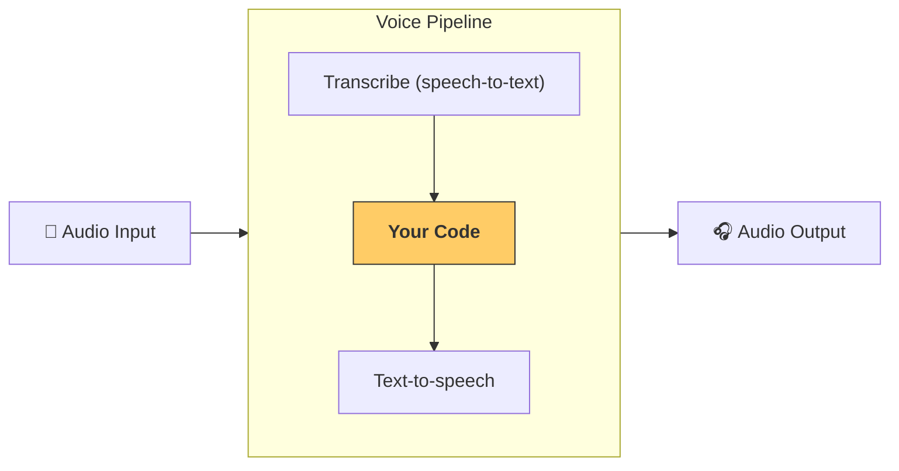

---
search:
  exclude: true
---
# 管道与工作流

[`VoicePipeline`][agents.voice.pipeline.VoicePipeline] 类可让您轻松地将智能体工作流转变为语音应用。您传入要运行的工作流，管道会负责转录输入音频、检测音频何时结束、在适当的时间调用工作流，并将工作流输出重新转换为音频。



## 管道配置 {#configuring-a-pipeline}

创建管道时，您可以设置以下几项：

1. [`workflow`][agents.voice.workflow.VoiceWorkflowBase]，即每次转录新音频时运行的代码。
2. 使用的 [`speech-to-text`][agents.voice.model.STTModel] 和 [`text-to-speech`][agents.voice.model.TTSModel] 模型。
3. [`config`][agents.voice.pipeline_config.VoicePipelineConfig]，可用于配置以下内容：
    - 模型提供商，可将模型名称映射到模型
    - 追踪，包括是否禁用追踪、是否上传音频文件、工作流名称、追踪 ID 等
    - TTS 和 STT 模型的设置，例如提示词、语言和使用的数据类型。

### 单智能体工作流的应用上下文传递 {#pass-application-context-to-a-single-agent-workflow}

当语音智能体、其工具或生命周期钩子需要应用状态或依赖项时，请将 `context` 传递给 [`SingleAgentVoiceWorkflow`][agents.voice.workflow.SingleAgentVoiceWorkflow]：

```python
from dataclasses import dataclass

from agents import Agent
from agents.voice import SingleAgentVoiceWorkflow, VoicePipeline


@dataclass
class VoiceContext:
    user_id: str


agent = Agent[VoiceContext](name="Voice assistant")
workflow = SingleAgentVoiceWorkflow(
    agent,
    context=VoiceContext(user_id="user-123"),
)
pipeline = VoicePipeline(workflow=workflow)
```

该工作流会将同一个上下文对象转发给它启动的每次智能体运行，包括后续的转录轮次。工具和生命周期钩子通过 [`RunContextWrapper.context`][agents.run_context.RunContextWrapper.context] 接收它。上下文仅保留在您的应用中，不会发送给模型。有关类型和生命周期的指导，请参阅[上下文管理](../context.md)。

### OpenAI语音模型配置 {#configure-openai-speech-models}

通过 `VoicePipelineConfig` 传递 [`STTModelSettings`][agents.voice.model.STTModelSettings] 和 [`TTSModelSettings`][agents.voice.model.TTSModelSettings]，以配置默认的OpenAI语音模型：

```python
from agents.voice import STTModelSettings, TTSModelSettings, VoicePipeline, VoicePipelineConfig

config = VoicePipelineConfig(
    stt_settings=STTModelSettings(
        language="en",
        prompt="A customer support call about product AC-42.",
    ),
    tts_settings=TTSModelSettings(
        voice="marin",
    ),
)
pipeline = VoicePipeline(workflow=workflow, config=config)
```

对于完整音频输入，`STTModelSettings.language` 和 `prompt` 会传递给转录请求。对于 [`StreamedAudioInput`][agents.voice.input.StreamedAudioInput]，配置 WebSocket 会话时，OpenAI转录会话还会接收 `language`、`prompt`，以及仅用于流式传输的 `languages` 和 `keywords` 设置。`gpt-transcribe` 和 `gpt-live-transcribe` 使用 `languages`（预期输入语言列表）和 `keywords`（音频中可能出现的字面术语列表）。设置 `languages` 后，其优先级高于 `language`。否则，这两个模型会接收单个 SDK `language` 值，并将其作为只包含一个元素的 `languages` 列表。其他转录模型仍会接收单值 `language` 字段。请使用 API 支持的语言代码，并使用 `prompt` 描述录音或其场景，而不是重复说明转录任务。关键词是转录提示，并非必须出现在输出中。请参阅OpenAI[转录上下文指南](https://developers.openai.com/api/docs/guides/transcription#improve-transcription-quality)。

对于可在预期语言之间切换的流式转录，请显式配置仅用于流式传输的字段：

```python
config = VoicePipelineConfig(
    stt_settings=STTModelSettings(
        languages=["en", "es"],
        keywords=["AC-42", "Agents SDK"],
        prompt="A customer support call about product AC-42.",
    ),
)
```

`TTSModelSettings.dtype` 接受可解析为原生 `int16` 或 `float32` 的 NumPy dtype 拼写形式，包括 `np.int16`、`np.float32`、`"int16"`、`"float32"`，以及 `"f4"` 等别名。当管道转换流式 TTS 音频时，其他 dtype 和非原生字节序会引发 [`UserError`][agents.exceptions.UserError]。

内置支持的 `TTSModelSettings.voice` 值包括 `alloy`、`ash`、`ballad`、`coral`、`echo`、`fable`、`onyx`、`nova`、`sage`、`shimmer`、`verse`、`marin` 和 `cedar`。声音是否可用取决于所选的文本转语音模型；有关当前各模型支持的声音，请参阅OpenAI[声音选项](https://developers.openai.com/api/docs/guides/text-to-speech#voice-options)。有权使用OpenAI自定义声音的组织可以改为传入自定义声音 ID：

```python
config = VoicePipelineConfig(
    tts_settings=TTSModelSettings(
        voice={"id": "voice_123abc"},
    ),
)
```

自定义声音仅向符合条件的客户开放，并且必须先通过OpenAI API 创建才能使用。有关访问权限、同意和创建要求，请参阅OpenAI[自定义声音指南](https://developers.openai.com/api/docs/guides/text-to-speech#custom-voices)。

[`OpenAIVoiceModelProvider`][agents.voice.models.openai_model_provider.OpenAIVoiceModelProvider] 使用其配置的 `AsyncOpenAI` 客户端处理非流式转录请求、TTS 请求和流式 STT 连接。流式 STT WebSocket 连接会从该客户端获取端点、身份验证和默认请求头，以及默认查询参数。有关提供商所有权和优先级规则，请参阅 [API 密钥与客户端](../config.md#api-keys-and-clients)。

## 管道运行 {#running-a-pipeline}

您可以通过 [`run()`][agents.voice.pipeline.VoicePipeline.run] 方法运行管道。该方法允许您传入以下两种形式的音频输入：

1. 如果您已有完整的音频输入，并且只想为其生成结果，请使用 [`AudioInput`][agents.voice.input.AudioInput]。当您不需要检测说话者何时结束讲话时，这非常有用；例如，使用预先录制的音频，或在用户结束讲话的时间点很明确的按键通话应用中。
2. 当您可能需要检测用户何时结束讲话时，请使用 [`StreamedAudioInput`][agents.voice.input.StreamedAudioInput]。它允许您在检测到音频分块时将其推送至管道，语音管道会通过称为“活动检测”的过程，在适当的时间自动运行智能体工作流。

## 结果 {#results}

语音管道运行的结果是 [`StreamedAudioResult`][agents.voice.result.StreamedAudioResult]。通过此对象，您可以在事件发生时以流式方式接收事件。[`VoiceStreamEvent`][agents.voice.events.VoiceStreamEvent] 包含以下几种类型：

1. [`VoiceStreamEventAudio`][agents.voice.events.VoiceStreamEventAudio]，包含一个音频分块。
2. [`VoiceStreamEventLifecycle`][agents.voice.events.VoiceStreamEventLifecycle]，通知您轮次开始或结束等生命周期事件。
3. [`VoiceStreamEventError`][agents.voice.events.VoiceStreamEventError]，表示错误事件。

应用使用 [`StreamedAudioResult.stream()`][agents.voice.result.StreamedAudioResult.stream] 时，会引发终止性的管道错误。如果语音转文本转录会话在其他流程均正常完成后仍无法关闭，流会引发该关闭错误，而不是无限期等待。如果该轮次已经失败，并且关闭转录会话也失败，流会保留原始轮次错误作为主要错误。

```python
result = await pipeline.run(input)

async for event in result.stream():
    if event.type == "voice_stream_event_audio":
        # play audio
        pass
    elif event.type == "voice_stream_event_lifecycle":
        # lifecycle
        pass
    elif event.type == "voice_stream_event_error":
        # error
        pass
```

## 最佳实践 {#best-practices}

### 中断 {#interruptions}

Agents SDK 目前未针对 [`StreamedAudioInput`][agents.voice.input.StreamedAudioInput] 提供任何内置的中断处理。相反，每个检测到的轮次都会触发工作流的独立运行。如果您想在应用内处理中断，可以监听 [`VoiceStreamEventLifecycle`][agents.voice.events.VoiceStreamEventLifecycle] 事件。`turn_started` 表示新的轮次已完成转录，并且即将开始处理。相应轮次的所有音频分发完毕后，会触发 `turn_ended`。您可以利用这些事件，在模型开始一个轮次时将说话者的麦克风静音，并在应用播放完与该轮次相关的所有音频后取消静音。